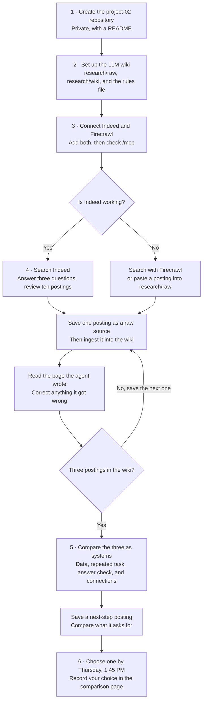

# Find three postings for Project 02

Session 20 · Tuesday, November 10, 2026

Project 02 starts with a real job posting. You'll read it as a description of a
system, then build that system. Today doesn't use AWS.

## Today's objectives

By the end of class, you'll have:

- A private Project 02 repository with an [LLM wiki](https://dexio.wiki/guides/llm-wiki/) for your research.
- A working way to find postings through Indeed, Firecrawl, or the browser fallback.
- At least one posting saved, ingested into the wiki, and checked against the source.

## Learning objectives

By the end of this lesson, you should be able to:

- Explain how a coding agent uses an MCP tool.
- Describe how raw sources, wiki pages, and the rules file work together.
- Identify accessible data, repeated work, a way to check answers, and two systems to connect in a job posting.
- Recognize a rate limit and switch sources without repeated retries.

By **Thursday, November 12, at 1:45 PM**, you'll have three postings saved
and one chosen. You'll also save one next-step posting, for a role that kind
of job can lead to in about two years.

Read the [Project 02 requirements](../projects/project-02.md) first. It
has four questions for choosing a posting you can build from.

Here's the path through today's guide.



## 0. Before you start

- Your GitHub account from the earlier lessons. If you still need one, sign up
  at https://github.com/signup. Apply for student benefits at
  https://github.com/settings/education/benefits. You can create the repository
  while verification is pending.
- An Indeed account. Create one at https://secure.indeed.com/auth if you don't have it.
- A Firecrawl account. Start with the student offer:
  https://www.firecrawl.dev/student-program. It offers eligible students 10,000
  free credits without a credit card. Sign up with your LMU email at
  https://www.firecrawl.dev/signin?view=signup. Open Settings, then Billing,
  and enter this coupon code:

  ```text
  STUDENTEDU
  ```

  Check that the credits appear before continuing. If the coupon is rejected,
  tell me.
- Your self-discovery file from Exercise 01, if you have it. Answering from
  memory is fine. Keep the file out of the new repository.

## 1. Create the Project 02 repository

Project 02 gets its own repository so your resume site stays stable while you
build.

1. Open https://github.com/new.
2. Name the repository `project-02`.
3. Choose Private.
4. Check "Add a README file," then click Create repository.

The repository starts private because it will hold copies of job postings and
your notes on jobs you're considering. We'll decide later what becomes public.

`project-02` is a working name. After you choose your posting, you'll rename
the repository for the system you're building.

5. Copy your new repository's URL from GitHub.
6. In VS Code, click File, then New Window.
7. Click "Clone Git Repository" on the Welcome page.
8. Paste your repository's URL.
9. Choose the parent folder that contains `career-platform`.
10. Open the cloned repository when VS Code asks.

Your two repositories should now sit beside each other. In the `project-02`
window, install and open the Claude Code extension:

1. Click View, then Extensions.
2. Search for "Claude Code."
3. Select "Claude Code" by Anthropic and click Install.
4. Click View, then Command Palette.
5. Search for:

   ```text
   Claude Code: Open in New Tab
   ```

6. Click that command to open Claude in the editor area alongside your file tabs.
7. Follow the sign-in prompts if they appear.

If the extension is already installed, start at step 4. Click Claude's prompt
box and enter this command to name the session:

```text
/rename project-02
```

## 2. Set up an LLM wiki

A posting is a page of text, and you'll research the company, the role, and
the field around it. An LLM wiki keeps that research in one place. Sources you
collect go in one folder and the agent never edits them. The agent writes and
updates linked pages in a second folder. A rules file tells the agent how to
keep the wiki. Andrej Karpathy describes the idea here:
https://gist.github.com/karpathy/442a6bf555914893e9891c11519de94f

Give the agent links to the assignment and the wiki notes. Start with an
interview:

```text
Read the Project 02 requirements:
https://raw.githubusercontent.com/LMU-ISBA/isba-4775-fa26/main/projects/project-02.md

Read Andrej Karpathy's LLM wiki notes:
https://gist.githubusercontent.com/karpathy/442a6bf555914893e9891c11519de94f/raw

I want a wiki to help me research and compare job postings for this
assignment. Interview me one question at a time about what I want to
explore and what I need help understanding. Use my answers to suggest
a simple setup. Wait for my agreement before creating files.
Never write personal details about me in this repository.
```

Answer the questions, and review the suggested setup. You can say you're
still exploring. Once the setup makes sense, ask:

```text
Create the wiki we discussed. Use research/raw/ for sources and
research/wiki/ for pages, including index.md and log.md.
Put the wiki rules in CLAUDE.md. Use plain Markdown links and lowercase
filenames with hyphens. Skip optional tools, and stop after setup.
```

If you use Codex, ask for `AGENTS.md` in place of `CLAUDE.md`.

Check that you have `research/raw/`, `research/wiki/index.md`,
`research/wiki/log.md`, and the rules file. Commit and push.

## 3. Connect Indeed and Firecrawl

You'll connect two sources, because either one can be slow or limited on a
given day. Indeed searches its own listings. Firecrawl searches the web and
reads a page into clean text, so it can pull a posting from an employer's own
careers site.

Indeed offers a connector for Claude. You add it once in the Claude app, and
Claude Code can then search postings for you.

1. Open https://claude.ai/customize/connectors.
2. Browse the connectors, find Indeed, and connect it.
3. Sign in to Indeed when it asks.
4. In VS Code, close your Claude Code session and open a new one.
5. Return to your session with the command below, and choose `project-02`.

```text
/resume
```

Then run:

```text
/mcp
```

Look for Indeed in the list, marked as coming from claude.ai.

Now add Firecrawl. Click Terminal, then New Terminal. Run:

```bash
claude mcp add --scope user --transport http firecrawl https://mcp.firecrawl.dev/v2/mcp-oauth
```

Run `/mcp` again, choose `firecrawl`, and authenticate with the Firecrawl
account from section 0. If you use Codex, add the same URL the way you added
Zoho in the [Zoho Mail guide](connect-coding-agent-to-zoho-mail.md#codex).

Both are the same idea as the Zoho Mail server from October 15: a tool your
agent calls.

Is this an agent you built, or a tool your agent uses? Say why in your own
words before the next step.

## 4. Search, then save your postings

Ask your agent:

```text
Search Indeed for roles that fit me. Ask me three questions first about
the work I want, then show me ten postings with their links.
```

Search again with different words if the first ten miss. Internships and
entry-level roles both count, and you don't have to qualify yet.

Indeed limits how many requests your account can make in a short time. That's
a rate limit, and every search and every posting your agent opens counts
toward it. Plan a search before you run it, read the ten results, and open
only the postings you might save. You'll put a rate limit on your own agent
later in Project 02, so notice what it's like from this side.

If Indeed is limited, or you want postings it doesn't list, ask through
Firecrawl:

```text
Use Firecrawl to search employer careers sites for [role] roles in
[city]. Show me ten postings with their links.
```

Pick three postings for jobs you could reach soon after graduation. Save and
ingest them one at a time:

```text
Save the full posting for [title] at [company] as a raw source, with its
link and today's date. Then ingest it into the wiki and stop.
```

Read the wiki page before you save the next posting:

1. In VS Code's Explorer, expand `research`, then `wiki`.
2. Open `index.md`, the wiki's list of pages.
3. Right-click the file's editor tab and choose "Open Preview."
4. Click the link for your posting to read its wiki page.

Compare it with the saved posting in `research/raw/`. Correct anything the
agent got wrong in the wiki page, and leave the raw source unchanged.
Postings can disappear from Indeed, so keep the saved copy for your project.
Finish at least one posting in class.

## 5. Compare the three as systems

Once all three are in the wiki, ask your agent:

```text
Compare my three postings as systems I could build for Project 02. For
each one, name a data source I can access, the question an agent would
answer, how I'd know the answer is right, and the two systems that would
connect. File the comparison in the wiki.
```

Use the four questions in
[Project 02 requirements, section 1](../projects/project-02.md#1-start-from-a-posting)
to decide which posting supports a project you can build:

1. Can you get the data? Check the source the agent named.
2. Does the job have a repeated question or decision your agent could handle?
3. Can you check whether the agent's answer is right?
4. Are there two systems you could connect for that work?

Read the postings alongside the comparison and correct unsupported claims.
Mark missing evidence as an open question before choosing a posting.

Then save one next-step posting: a role that jobs like your three can lead
to in about two years. Ingest it the same way. You don't have to want that
job, and you won't build for it. It's there so you can see how the work
progresses. Ask your agent:

```text
Compare the next-step posting with my three. What does it ask for that
they don't? File the answer in the wiki.
```

Commit and push.

## 6. Due Thursday, November 12, at 1:45 PM

- Three postings saved and ingested, and the comparison page written.
- One posting chosen. Write your choice and your reason at the top of the
  comparison page. Give a reason about the system, not about you.
- One next-step posting saved, with the page on what it asks for.
- Have a model API key ready for Thursday's first agent call. The
  [Claude API setup](claude-api-access.md) takes about 15 minutes and $5, and
  class demos use it. A key from another provider works too. Keep the key in
  `.env` in your `project-02` folder, and never in chat.

You can switch to another of your three postings until Tuesday, November 17.
If none of your three meets all four criteria, message me before Thursday.

