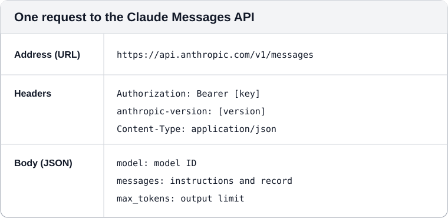

# Your first model call

Session 21 · Thursday, November 12, 2026

Your Project 02 agent will ask a model to do the job's repeated work. Today
you'll get real data for your posting and send one record to a model by hand.
You'll see what a model call is before your code makes one. Today doesn't use
AWS.

## Today's objectives

By the end of class, you'll have:

- About 20 real records for your posting, saved with their source and date.
- A working model API key.
- Three calls on one of your records: a default question, your own question,
  and your question answered as JSON.

## Learning objectives

By the end of this lesson, you should be able to:

- Name the parts of a request to a model API: the address, the headers, and
  the body.
- Find the answer, the token counts, and the stop reason in a response.
- Work out what one call cost.
- Explain how asking for JSON changes the request and the response.
- Say what your own question found that a default question missed.

## 1. Check your posting

Keep your postings-guide Claude Code tab open so you can refer back to it.
In the same VS Code window, open View, then Command Palette. Choose:

```text
Claude Code: Open in New Tab
```

In the new tab's prompt box, enter:

```text
/rename first-model-call
```

Open your comparison page in `research/wiki/`. Your choice and your reason
should be at the top. If you haven't chosen, choose now. You can switch among
your three postings until Tuesday, November 17.

## 2. Get real data

One record is one item your system will work on. A CSV stores rows and
columns as plain text, which you can open in a spreadsheet.

Your agent needs real records to work on. The
[Project 02 requirements](../projects/project-02.md#data) give the order to
look in: an API or open data first, then public pages whose terms allow
scraping. A CSV you can download counts. An employer's private data doesn't.

Ask your agent:

```text
Find real data for my chosen posting. Look for an API, open data, or a
CSV I can download first. Show me three sources with the row count and
why each fits. Then stop.
```

Pick one and check that the records are real and not generated. Then ask:

```text
Save about 20 real records from this source with its URL and today's
date. Add the source to the wiki, then stop.
```

Open the file and read three records. Each one should be real, and it should
be something the job's repeated question could be asked about.

If the source doesn't work, try these in order:

1. Another of the three sources, or the one named in your comparison page.
2. An open data portal for the posting's industry, such as data.gov, BLS,
   Census, SEC EDGAR, FRED, CMS, or LA Open Data.
3. A dataset on Kaggle or Hugging Face. Skip teaching sets such as Titanic
   and Iris.
4. Real records from the same industry, if the company's own aren't public.
5. Another of your three postings.

```text
Commit and push.
```

## 3. Set up your API key

An API key identifies your account and authorizes requests billed to it.
Follow the [Claude API setup](claude-api-access.md), sections 1 through 5.
You're done when step 5 lists the available models. Keep that list.

Keep the key in `.env`, excluded from Git. You may also save it in your
password manager. Never paste it into chat, source code, or documentation.
If you chose another provider, set up its key the same way and give your
agent that provider's docs in section 4.

## 4. Send one record to the model

The [Messages API](https://platform.claude.com/docs/en/api/messages/create)
lets your code send Claude a request with instructions and data, then
receive a response. Today you'll use [curl](https://curl.se/docs/tutorial.html),
a command-line tool that sends web requests. The docs link below tells your
agent how to build the request.

A request has an address, headers carrying settings such as your key, and a
body holding the model, instructions, and data. The body uses
[JSON](https://www.json.org/json-en.html), a text format with named fields
and values. The shell runs the command, and flags set its options.



Pick one record from your saved data. If your data is a CSV, include the
header line and one row.

Pick a model ID from the list you saved during API setup. Replace `[model]`
below with that exact ID.

Send a default question first. This prompt also sets the rules for today's
calls:

```text
Use curl for today's model calls. Load my key from .env in the shell.
Never open .env, print the key, or use verbose mode. Save each request
body and raw response as files. Show each command with one flag per line.

Read the API docs first:
https://platform.claude.com/docs/en/api/messages/create

Send one record from my data to [model] and ask: What do you see in
this record? Show me the command you ran, then stop.
```

Read the saved files yourself. The raw response is the API's full reply,
before your coding agent summarizes it.

In the command, find:

- The address the request went to.
- The header that carries your key. It should show a variable name and not
  the key.
- The [version header](https://platform.claude.com/docs/en/api/versioning).
  Its date sets the format of the request and the response. It isn't the
  model, and it isn't today's date.

In the request file, find:

- The model.
- The question.
- Your record.

Tokens are chunks of text the model processes or generates. The stop reason
says why generation ended. In the response file, find:

- The answer.
- `input_tokens` for what you sent and `output_tokens` for what the model
  generated.
- `stop_reason`.

If your key appears anywhere except `.env` or your password manager, delete
it in the Console and make a new one. Section 3 of the
[Claude API setup](claude-api-access.md) shows where.

## 5. Ask your own question

Ask your agent to help you choose a useful question for your posting and data:

```text
Read my chosen posting and the record we just sent. Ask me two
multiple-choice questions, one at a time, to help me decide what would
be useful to learn from this record.

Then suggest one question this record can answer. Let me revise it.
Don't send a model call yet.
```

Choose a question this record can answer on its own. Replace
`[your question]` below with yours, then send:

```text
Send the same record again and ask: [your question]. Save the request
and response beside the first ones.
```

Compare the two answers. What did your question make more useful for the
job's task? Point to a specific difference, or explain why it didn't help.

Input and output tokens have different
[prices per million tokens](https://platform.claude.com/docs/en/about-claude/pricing).
Ask your agent to calculate the costs from the saved responses:

```text
Calculate each call's cost from its saved response and these prices:
https://platform.claude.com/docs/en/about-claude/pricing

Show the model, input tokens, output tokens, and cost in a table.
Show the rates and arithmetic for one call so I can check it.
```

Check that calculation against the response's token counts and the pricing
page. Keep the table for the next call.

Open [Usage](https://platform.claude.com/usage). Select today and your
project's API key, then compare the token totals with your saved responses.
Open [Cost](https://platform.claude.com/cost) to see the spending recorded
for your model. If nothing appears yet, continue and check again later.

## 6. Ask for JSON

Now ask the model to return its answer as JSON too. A
[schema](https://json-schema.org/understanding-json-schema/about) describes
the expected fields and value types, such as text or numbers.
[Structured output](https://platform.claude.com/docs/en/build-with-claude/structured-outputs)
adds that schema to the request to control the answer's format.

Ask your agent to suggest fields that would help your system use the answer:

```text
Based on my question and the answer we just got, suggest three sets
of JSON fields. Keep each set to two or three fields. Explain what
each set would help my system do, and recommend one with a reason.

Ask me to choose or revise a set. Don't send a model call yet.
```

Choose or revise a set, then send:

```text
Read the structured outputs docs first:
https://platform.claude.com/docs/en/build-with-claude/structured-outputs

Send the same record and my question again, and ask for JSON with
the fields I chose. Save the new request and response beside
the others.
```

Compare this request and response with the ones for your question. What did
the request add? How did the answer change?

Check each field against the record yourself. Then ask:

```text
Add this call to the cost table using its saved response. Compare its
cost with the earlier calls.
```

Is this an agent yet? Say why in your own words. We'll come back to it on
Tuesday, when the model chooses a tool.

Check that no project file except `.env` holds your key. Then ask:

```text
Commit and push.
```

## 7. Due Tuesday, November 17, at 1:45 PM

M1 is due, and the
[Project 02 requirements](../projects/project-02.md#dates) list it in full.
It's graded when it's due, and it counts for 60 of the project's 300 points.

A product requirements document (PRD) describes who your system serves,
what it does, and what it leaves out. An architecture describes the parts
that make it work and how they connect.

- Your PRD, your data source, and your next-step posting.
- Two architectures with cost estimates, your choice, and your reason.
- A diagram of the design you chose.
- Your repository renamed for your system, with me invited as a collaborator.
- Your repository URL, submitted in the Project 02 M1 assignment in Brightspace.

Keep building after you submit. I'll read your design and tell you by
Thursday, November 19, if something has to change.

Sections 2 through 6 are Exercise 08, due at the same time. It's credit/no
credit, and I check it in your Project 02 repository: your records, and the
request and response files for all three calls. Submit your repository URL
and the paths to those files in the Exercise 08 assignment in Brightspace.
If you didn't get a record or a call in class, finish those sections first.

Start the PRD with an interview:

```text
Interview me to write a PRD for my Project 02 system: who uses it, what
it does, and what it leaves out. Ask one question at a time.
```

Then ask for two designs:

```text
Design two AWS architectures for this PRD that differ in a way that
matters. For each, give a diagram, a monthly cost estimate, what it
makes easy, and what it makes hard.
```

Write the choice and the reason yourself. Say what you gave up.

The idea behind today's first two calls comes from Dan Shipper's talk on
human work after automation. It's optional, and the part to watch runs from
10:18 to 19:30: https://www.youtube.com/watch?v=WstNofgQF5Q
