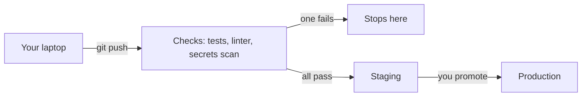
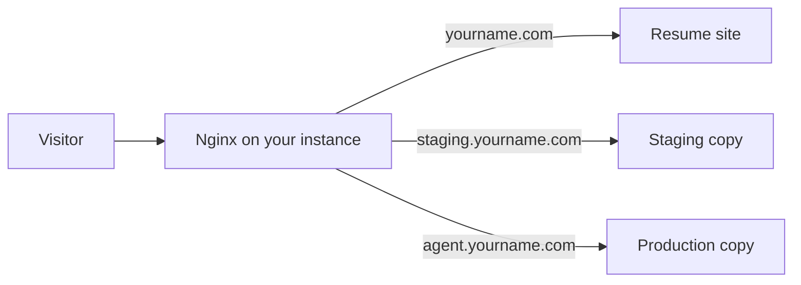

# Staging and production

Session 24 · Tuesday, November 24, 2026, on Zoom

Your agent runs when you type a command on your laptop. Nobody else can use
it, and there's only one copy, so a change can't be checked anywhere before
it's the real thing. Today you'll put the agent behind a web page. Then a
change moves through three places before a visitor sees it: your laptop, a
staging site, and production.

## Objectives

By the end of class, you'll have:

- A page with a question box and an `/ask` route that runs your agent,
  behind a shared password.
- Tests, a linter, and a secrets scan that run on every push.
- A staging site on your EC2 instance, deployed by GitHub Actions when you
  push.
- One release decision: the commit you tested, what you observed, and
  whether you'd release it.

By M2 on Tuesday, December 1, you'll also have a production site, and one
change that moved from staging to production. Some of you will get there in
class. Section 5 is written so you can finish it on your own.

## Learning objectives

By the end of this lesson, you should be able to:

- Say what local, staging, and production are each for.
- Explain the difference between a check you run by habit and a check the
  pipeline enforces.
- Follow one commit from your laptop to production.
- Explain how GitHub Actions deploys to a server that only accepts SSH from
  your IP address.
- Say where your API key lives in each environment, and why it isn't in the
  repository.
- Say what CI and CD mean, and point to each one in your own project.
- Say how continuous delivery differs from continuous deployment.
- Decide whether a tested commit should be released, and say what you
  observed that supports it.

## Three environments

An environment is one running copy of your app. Each copy has its own
address, its own settings, and its own job.

| Environment | Where it runs | Who sees it | What it's for |
| --- | --- | --- | --- |
| Local | Your laptop | You | Building and trying things |
| Staging | staging.yourname.com | You | Checking a change on the real server before visitors get it |
| Production | agent.yourname.com | Anyone with the password | The copy people use |

A change moves in one direction:



### How a change moves

Nothing is copied by hand. What moves is a commit, which is one saved
version of your code with a short code such as `52e00d7`. The same commit
goes to each place, one move at a time:

| Move | What starts it | What does the work | What happens |
| --- | --- | --- | --- |
| Laptop to GitHub | You run `git push` | Git on your laptop | GitHub receives your commit |
| The checks | The push | GitHub's computers | Tests, the linter, and the secrets scan run on that commit. Nothing moves yet |
| GitHub to staging | The checks passing | A small program on your instance, called a runner | It copies that commit into the staging folder and restarts staging |
| Staging to production | You, when you choose to promote | The same runner | It copies the commit staging is running into the production folder and restarts production |

GitHub Actions coordinates all of it. It holds the commit, knows which
checks passed, tells each computer what to do, and keeps a record of every
run. Two moves happen on their own, and the last one waits for you.

Each page shows its commit at the bottom. That's how you tell which version
an environment is running, and whether staging and production match.

## A habit and a gate

Teams check code in more than one place. A check on your laptop is fast, and
you can skip it. A check in the pipeline is slower, and nothing deploys
until it passes.

| | On your laptop | In the pipeline |
| --- | --- | --- |
| When | Before you commit | After you push |
| What runs | `/code-review` and `/security-review` | Tests, a linter, and a secrets scan |
| Can you skip it? | Yes, so it's a habit | No, so it's a gate |

The gate has a name, CI, and the next section defines it.

## CI and CD: what's ahead

Job postings say "CI/CD" as if it were one thing. It's two, and you'll
build both today.

CI is continuous integration. Every time you push, a machine checks your
change right away, so a problem shows up in minutes, while the change is
still small. "Integration" means your change joining the code that's
already on main.

CD is what happens to a change after it passes. It has two forms, and they
share the same letters:

| | Continuous delivery | Continuous deployment |
| --- | --- | --- |
| After the checks pass | The change is deployed somewhere safe, such as staging, and is ready to release | The same |
| Who releases it to production | A person, with one action | Nobody. The pipeline does it |
| What you need to trust it | Checks, plus a person who looked | Checks strong enough to stand in for that person |

The only difference is who makes the last move. Today you build continuous
delivery, because you promote by hand. If that step ran by itself, it would
be continuous deployment.

Here's where each one shows up today. Each section says so again when you
get there.

| Section | What you do | CI or CD |
| --- | --- | --- |
| 1 | Build the app on your laptop | Neither yet. This is local |
| 2 | Write tests and add a linter | CI. These are the checks |
| 3 | Set up two places on your instance, and a runner | CD. These are where a change gets delivered |
| 4 | Run the checks on every push | CI |
| 4 | Deploy to staging when the checks pass | CD |
| 5 | Decide, then promote to production by hand | CD. The person in continuous delivery is you |

Two more words go with these:

| Term | What it means |
| --- | --- |
| Pipeline | The steps a commit goes through, in order, from push to production. Yours is two GitHub Actions workflows |
| DevOps | The people who build the software also deploy it and keep it running, with automation doing the handoffs |

Before DevOps, a development team wrote the code and handed it to a
separate operations team to run. Releases were rare, and each team blamed
the other when one failed. DevOps puts both jobs on one team and automates
the handoff. GitHub Actions is the tool we'll use. It's GitHub's service
that runs steps for you when something happens in your repository, such as
a push. Jenkins, GitLab CI, and AWS CodePipeline do the same work.

Some jobs own this work: DevOps engineer, site reliability engineer,
platform engineer, and cloud engineer. Most of those postings ask for two
to five years, so think of them as a second job. The first jobs use it
every day without the title. A technical support engineer reads a failed
deploy, an implementation specialist ships a customer's setup, and a data
analyst's report runs in a pipeline someone else built. Postings for those
jobs list CI/CD, Git, or GitHub Actions as a skill.

## 0. Before class: check your access

Do this on the day of class, from the network you'll use for class. Two
things have changed since the AWS migration, and both stop today's work.
Your AWS CLI sign-in has expired, and your instance only accepts SSH from
the IP address you had when you launched it. From a different network, SSH
times out.

In the browser, sign in to the AWS console as isba-student, not as root.
Then sign in the CLI and check who it thinks you are:

```bash
aws login --profile isba-4775 --region us-east-1
aws sts get-caller-identity --profile isba-4775
```

Find the line that starts with `"Arn"`. It should end in
`user/isba-student`. If it ends in `:root`, follow the fix in section 5 of the
[AWS migration guide](aws-migration.md). The sign-in doesn't last a full
day, so run both commands again if you did this the night before.

Open your Project 02 repository in VS Code and start a new Claude Code
session named with:

```text
/rename staging-and-production
```

You set up your instance from your career-platform repository, and this
session has never seen it. AWS can tell your agent what it needs. The
prompt uses five terms from the AWS migration:

| Term | What it means |
| --- | --- |
| AWS CLI profile | The saved sign-in your agent uses to run AWS commands. Yours is named `isba-4775` |
| Public address | Where your instance sits on the internet. Yours is an Elastic IP, so it stays the same when the instance restarts |
| Key pair | Two matching files that prove it's you when you connect with SSH. AWS holds the public one, and the private one is on your laptop in `~/.ssh` |
| Security group | The firewall around your instance. It's a list of rules, and each rule says which addresses can reach which port |
| SSH rule | The rule in that list for port 22, the port SSH uses. Yours allows one address |

Ask:

```text
Using the AWS CLI profile isba-4775, find my EC2 instance in
us-east-1: its public address, its key pair name, and its security
group. Find the matching private key in ~/.ssh and test SSH. If SSH
fails, find out why before you change anything. If my IP address
changed, replace the SSH rule in the security group with my current
address only. Then confirm that SSH works and that my resume site
still loads. Write the address and the key's path in
docs/instance.md, with no secrets.
```

If you change networks again, run this prompt again.

### Choose your known question

You need one question whose answer you can check, so you can tell whether
each copy of your app works. A password prompt only tells you that
something is asking for a password.

Your instance gets only what's in Git. If your full dataset was too large
to commit, make sure a sample is committed, and choose a question the
sample can answer. A count or a comparison works well, such as "How many
records are from October 2026?"

Replace the bracketed part, then ask:

```text
Run agent.py with this question: [your question]. Use only the data
that's committed to this repository. Save the question, the answer,
and today's date in docs/known-question.md.
```

Check the answer by hand against your data. You'll ask this question three
more times today: on your laptop's page, on staging, and on production.

## 1. Build the app on your laptop

Use the session you named in section 0. If you closed it, start a new one
in your Project 02 repository and give it the same name.

Your agent needs a way in. Right now only you can run it, from a terminal.
A web app gives it an address, so a person with a browser can ask it a
question. The prompt uses these terms:

| Term | What it means |
| --- | --- |
| FastAPI | The Python framework your resume site uses. It turns Python functions into web addresses |
| Route | One address inside your app. The route `/ask` takes a question and returns the agent's answer |
| Markdown | Plain text with marks for headings, bold, and tables. Your agent writes its answers in it |
| Shared password | One password for everyone you let in. There are no user accounts |
| The environment | Settings your app reads when it starts, kept outside the code. On your laptop they live in `.env` |
| Server log | The running record your app writes while it works. It's where you look when an answer is wrong |
| Environment name | A label that says which copy this is: local, staging, or production |
| Commit | One saved version of your code in Git, named by a short code such as `15b3c0d` |

Ask your agent:

```text
Read agent.py. Build a small web app around it with FastAPI:

- One page with a question box.
- One route, /ask, that takes the question, runs the agent loop in
  agent.py, and returns the answer.
- If the answer comes back as markdown, show it formatted, not as
  plain text.
- A shared password in front of the page and the route. Read it from
  the environment, never from the code.
- Write each agent step to the server log: the question, the tool and
  its inputs, how much came back, and why the run stopped. Never log
  the password or my API key.
- At the bottom of the page, show the environment name and the commit
  the app is running.

Keep agent.py working from the command line. Ask me before you add
anything else. Then run the app on my laptop. Tell me the address,
and what to type if my browser asks for a user name.
```

Check it yourself:

1. Open the address and enter the password.
2. Ask your known question. Compare the answer with
   `docs/known-question.md`.
3. Open the address in a private window and skip the password. The app
   should refuse you.
4. Ask one vague question, such as "show me a report." Write down what the
   agent does. You'll use it in section 5.

On the command line, `agent.py` prints each step. Behind a page you only
see the answer, so the steps have to go to a log. Ask:

```text
Show me the log lines for my last question, and tell me where the
log is.
```

Find the tool call, what it was given, and why the run stopped. This log
is where you'll look when an answer is wrong.

The password is your access gate. Every question costs you API credits, so
only people you allow should reach the agent.

Now run the two reviews, one at a time:

```text
/code-review
```

```text
/security-review
```

Read the findings and fix the ones you agree with. You decide what gets
fixed, and you can leave a finding alone if you can say why.

## 2. Add checks a machine can run

This is where CI starts. CI needs checks that run without a person, and you
write them here.

In section 4, GitHub will check your code every time you push, and it will
deploy only if the checks pass. Nobody watches that happen, so each check
has to answer pass or fail without a person. You'll add two kinds of check
now, on your laptop, so you know they pass before GitHub runs them.

| Check | What it does | An example from your app |
| --- | --- | --- |
| A test | Runs a piece of your code and compares the result with the answer you expect | Ask for the page without the password, and expect to be refused |
| A linter | Reads your code without running it and checks every line against a list of rules. Each rule describes a known problem, such as a name that's used but never defined | A file that imports `json` and never uses it |

A linter is to code what a spelling and grammar checker is to an essay. It
catches a misspelled name or a sentence that doesn't parse, and it does
that in a second, without running anything. It can't tell you whether the
essay's argument is right. That's the tests' job: they run the code and
check what it does.

Ruff is the linter we'll use. It has a few hundred rules, and each has a
short code. This is what one result looks like:

```text
app.py:3:8: F401 `json` imported but unused
```

Read it left to right: the file, the line and column, the rule's code, and
what's wrong. Here, line 3 of `app.py` imports something the file never
uses.

The tests won't call the model, because a model call costs money and can
answer differently each time. A check has to give the same result every
time.

Ask your agent:

```text
Add tests and a linter to this project.

Tests: cover the app and the tool in agent.py. They must run without
calling the model and without my API key. One test must show that a
request without the password is refused.

Linter: use ruff.

Run both and show me the results, with the one command that runs
each. If a test fails, tell me why. Don't delete it.
```

Here's what you should see:

- For the tests, a count and the word OK or passed.
- For ruff, either "All checks passed!" or a list of findings. A finding is
  one place where your code breaks one of ruff's rules, in the format
  above.

Ruff usually has findings in files from earlier lessons, such as
`workflow.py`. They're about style, and your code still works. Fix them
now, because one finding will stop the deploy in section 4:

```text
Fix the ruff findings without changing what the code does. Then run
the tests and ruff again.
```

Now look at one test yourself:

```text
Show me the test that checks the password. Explain in plain words
what it sends and what answer it expects.
```

Could you explain that test to a classmate? If not, ask your agent again in
your own words.

Last, save your work. Your key and your password belong in `.env`, which
Git ignores, and nowhere else:

```text
Check that my API key and my password aren't in any file that Git
will commit. Then commit and push.
```

You're done with this section when the tests pass, ruff passes, and your
push shows up on GitHub.

## 3. Get your instance ready

This section is the groundwork for CD. Delivery needs somewhere to deliver
to, and something on your instance that can receive a commit.

Your instance runs one site now, your resume site. After this section it
will have room for two more: a staging copy and a production copy of your
Project 02 app. You do this setup once, and every deploy after it reuses
it.

Nginx is already the front door of your instance. It reads the name a
visitor asked for and sends the request to the right site:



### Start at the board

We'll work this out together in class before anyone reads the table below.
Your resume site is live on your instance, so you already know most of the
answer. Think about three questions:

1. What had to exist on your instance before a visitor could see your
   resume site?
2. For a second and a third copy of a site, which of those do you need
   again, and which can all three share?
3. GitHub's computers can't SSH into your instance. How could GitHub get
   your code there?

If you're working through this guide on your own, write your answers down
before you read on.

### Compare it with this

Each copy needs the same six parts your resume site has:

| Part | What it is |
| --- | --- |
| A DNS record | Points the copy's name at your instance |
| A folder | Where that copy's code sits on the instance |
| A service | The program that keeps the copy running and restarts it after a reboot |
| A port | The number Nginx uses to reach that copy. Each copy gets its own |
| An environment file | A file on the instance with that copy's API key, password, and environment name |
| A certificate | What lets a browser show the padlock for that name. Let's Encrypt issues it for free, and Certbot is the tool that asks for it, as on October 6 |

### The two names

Everyone uses the same two names: `staging.yourname.com` for staging and
`agent.yourname.com` for production. In every prompt and command below,
replace `yourname.com` with your domain.

### Point the names at your instance

A name has to point at your instance before anyone can visit it, and before
a certificate can be issued for it. The prompt uses three terms:

| Term | What it means |
| --- | --- |
| Cloudflare CLI | The command-line tool your agent used to change DNS in the Railway lesson |
| A record | The DNS entry that says "this name is at this address" |
| DNS only | Cloudflare hands out your instance's address and stays out of the way, the same as your resume site. The other setting, proxied, puts Cloudflare between the visitor and your instance |

Ask:

```text
Using the Cloudflare CLI, add two A records that point at my
instance's Elastic IP, DNS only: staging and agent. Don't
change any other record.
```

Check it from your laptop:

```bash
nslookup staging.yourname.com
nslookup agent.yourname.com
```

Each answer should end with your instance's address, the one in
`docs/instance.md`. If a name isn't found, wait a minute and try again.

### How GitHub reaches your instance

In section 4, GitHub Actions will copy your code to your instance. It does
its work on a runner, which is the computer that carries out the steps.
GitHub has its own runners, but they can't SSH into your instance, because
port 22 only allows your IP address. You saw that rule in section 0.

So your instance gets a runner of its own. It's a small program that asks
GitHub, "Is there a job for me?" The instance starts the conversation, so
nothing new opens on your firewall.

Use a runner like this only on a private repository. On a public one, a
stranger's pull request could run code on your instance.

### Ask for a plan

This is the largest change you've made to your instance, and your resume
site lives there. So you plan it first, the way you did for the Azure VM on
September 24 and October 1, with the writing-plans skill from Superpowers.
The skill saves the plan as a file. If class ends before you finish, the
file is how you pick the work up at home.

The prompt uses the six parts from the table above, and seven more terms:

| Term | What it means |
| --- | --- |
| Routes by hostname | Nginx reads the name in the address, such as `staging.yourname.com`, and sends the request to the copy with that name |
| GitHub Actions | GitHub's service that runs steps for you when something happens in your repository, such as a push |
| Runner | The computer that carries out those steps. GitHub lends you one for each job, and you can add your own |
| Self-hosted runner | A runner you add yourself. Here it's a small program on your instance, and not one of GitHub's computers |
| Run as a service | Started by the system and kept running, so it comes back after a reboot without you |
| Permissions | What a program is allowed to change on the instance. The runner needs very few |
| Skill | A set of written instructions your agent loads for one kind of job. writing-plans is the one for plans |

```text
Plan how to run two copies of this app on my EC2 instance, next to
my resume site: staging at staging.yourname.com and production at
agent.yourname.com. The instance's details are in
docs/instance.md.

Each copy gets its own folder, service, port, environment file, and
Let's Encrypt certificate. Nginx routes by hostname. My resume site
has to keep working.

Include a GitHub Actions self-hosted runner for this repository,
run as a service. Later, a workflow will use it to copy a commit
into one of those folders and restart that copy's service, so give
it only the permissions that needs.

Stop at the runner. Don't write a workflow, and don't copy the app's
code to the instance. I'll build the pipeline next: staging on every
push, and production only when I promote by hand.

Keep the plan small enough to read in five minutes. Don't add tests
or change files in this repository.

Use your writing-plans skill and save the plan to
docs/superpowers/plans/2026-11-24-staging-and-production.md. Explain
each section for a beginner, and say where each step runs, how we'll
check it, and how to undo it. Don't run anything yet.
```

Open the plan in VS Code, under `docs/superpowers/plans/`. Find these four
things in it. If one is missing, ask your agent to add it before you go on.

- The two ports. They have to differ from each other and from your resume
  site's port.
- The two environment files, and where they are.
- What the runner is allowed to do. It should be able to write to the two
  folders and restart the two services, and nothing more.
- The step that could break your resume site, and how the plan checks for
  that.

Then ask the plan one more question: which step here could change what
production is running? The answer should be none. This plan only prepares
the instance. If it writes a workflow or copies your code, ask your agent
to take that part out, because that's the pipeline, and you build it in
sections 4 and 5.

### Build it

Run the plan one section at a time. "Native execution" in the prompt means
this session does every task itself, in order, and doesn't hand tasks to
other agents:

```text
The plan looks good. Let's work on the first section using native
execution in this session. As each section finishes, write what ran
and what the checks showed under that section of the plan. Tell me
what you need from me.
```

The agent will ask you to approve commands, and it may ask you for
something from GitHub to register the runner. Read each request before you
approve it. After each section, read what it reports, then say:

```text
Let's work on the next section.
```

If you have to stop, or you start a new session, the plan file remembers
where you were:

```text
Read @docs/superpowers/plans/2026-11-24-staging-and-production.md
and docs/instance.md. Where are we, and what's next?
```

Next, give each copy its settings. The API key and the passwords go in the
environment files on your instance, and GitHub never sees them. Choose two
different passwords of at least 12 characters and write them down, since
you'll submit both for M2:

```text
Copy my API key from .env into both environment files on the
instance without printing it. Set the environment name to staging in
one and production in the other. Ask me for a different password for
each.
```

### Check it

Open each of these and compare what you see:

| Open | You should see | What it means |
| --- | --- | --- |
| `https://staging.yourname.com` | A padlock and "502 Bad Gateway" | Nginx answered and the certificate works. No app is behind it yet, because no code has been deployed |
| `https://agent.yourname.com` | A padlock and "502 Bad Gateway" | The same, for production |
| Your resume site | The site, as before | The new setup didn't disturb it |
| Your repository on GitHub, then Settings, Actions, Runners | Your runner, marked Idle | The runner is connected and waiting for a job |

The 502 is what you want here. It's the gap the pipeline fills in section
4. If you see anything else, such as a page that won't load, a certificate
warning, or a runner marked Offline, tell your agent exactly what you see.

You're done with this section when all four rows match.

## 4. Deploy to staging with GitHub Actions

Now you build the pipeline's first half. From here on, a push to GitHub
does three things without you: it runs your checks, it deploys to staging
if they pass, and it stops if one fails.

This section turns on CI and the first half of CD. Running the checks on
every push is CI. Deploying to staging when they pass is CD.

These words come up in this section:

| Word | What it means |
| --- | --- |
| Workflow | A file in your repository that tells GitHub Actions what to do, and when. Yours will run on every push |
| Job | One group of steps inside a workflow. Each job runs on one runner |
| Secrets scan | A check that reads your commits for anything that looks like a key or a password. Gitleaks is the tool |
| Push to main | Sending your commits to the main branch on GitHub. It's the event that starts the workflow |
| Deploy | Copy one commit's code to the place it runs, then restart the service so it uses the new code |
| GitHub's runner and your runner | GitHub's runners do the checks. Your self-hosted runner, from section 3, does the deploy, because only it can reach your instance |

Ask:

```text
Write a GitHub Actions workflow for this repository.

On every push to main, run the tests, ruff, and a gitleaks secrets
scan on GitHub's runner. If all three pass, deploy that commit to
staging on my self-hosted runner and restart the staging service. If
one fails, nothing deploys.

The instance has no Git folder, so have the deploy record the commit
where the app can read it, and show it at the bottom of the page.

Before I commit, explain each job to me in one line.
```

You should hear about four jobs: the tests, ruff, the secrets scan, and the
deploy. The first three run on GitHub's runners. The deploy runs on yours,
and only after the other three pass. That "only after" is the gate.

The first three jobs are your CI. The fourth is the start of your CD.

Before you push, predict it. What will run first, and what happens to the
deploy if ruff fails? Then ask:

```text
Commit and push.
```

If GitHub rejects the push with a message about the workflow scope, paste
the error to your agent. Your GitHub sign-in needs permission to change
workflow files.

### Watch it run

In your repository on GitHub, open the Actions tab and choose the newest
run. You'll see the four jobs. Each one turns into a green check mark when
it passes. The run takes a few minutes.

While it runs, check your own postings for today's terms:

```text
Search my saved postings in research/ for CI/CD, DevOps, pipeline,
deployment, GitHub Actions, and staging. Show me each line you find
and which posting it's from. Don't summarize.
```

Two things can go differently, and both are worth seeing:

- A check shows a red X. That's the gate doing its job, and nothing was
  deployed. Open the job, copy the error, and give it to your agent.
- The deploy job says it's waiting for a runner. Your runner is offline.
  Tell your agent, and it can restart the runner on your instance.

### Check staging

When all four jobs are green:

1. Open `https://staging.yourname.com`. The 502 is gone, and the browser
   asks for a password.
2. Enter the staging password.
3. Read the bottom of the page. It should say staging, with a commit.
4. Run `git log -1` on your laptop. The commit should match the page.
5. Ask your known question on the page. Compare the answer with
   `docs/known-question.md`.
6. Ask your coding agent for the log of that question:

```text
Show me the staging log lines for the question I asked a moment ago.
```

The steps are the same ones you read in section 1. They're on your instance
now, and not on your laptop.

Production still shows the 502. The pipeline only goes as far as staging,
and that's on purpose.

You're done with this section when staging answers your known question and
shows the commit you pushed. This is today's target for class.

## 5. Promote to production

If class ends before you reach this section, it's your work before M2. The
last part of section 6 says how to pick it up.

This is the second half of CD, and it's what makes yours continuous
delivery: a person decides. Staging is where you find out whether a change
is right. Production is what other people use. To promote a commit is to
move the one you tested on staging into production.

### Decide

Before anything goes to production, make a release decision you can
defend. Three questions:

1. Which commit did you test? Read the seven characters at the bottom of
   your staging page.
2. What did you observe? Ask your known question on staging and compare the
   answer with `docs/known-question.md`.
3. Would you release it, or hold it?

Green check marks tell you the checks passed. They don't tell you the
answer is right. In my rehearsal, all 43 tests passed while the agent
searched the wrong dates. The checks and your own observation are two
separate kinds of evidence, and a release needs both.

In class, you'll type "release" or "hold" in the Zoom chat, with the one
thing you observed. If your staging site isn't up yet, judge the one on my
screen.

### Build the Promote workflow

The workflow asks for the commit you tested, so it can't send a different
one by accident. If you pushed again after testing, staging has moved, and
the workflow should stop.

```text
Add a second workflow named Promote that I start by hand from the
Actions tab. It asks me for the seven-character commit I tested on
staging. If staging is running a different commit, it stops and
changes nothing. Otherwise it deploys that commit to production and
restarts the production service. If production doesn't answer after
the restart, the run fails and says so. Write the promoted commit in
the run's summary.
```

Then:

```text
Commit and push.
```

This push runs your checks and deploys to staging again, because every push
does. Wait for the run to finish. Staging now shows a new commit, so read
it again and ask your known question once more.

### Promote it

1. Read the seven-character commit at the bottom of your staging page.
2. In your repository on GitHub, open the Actions tab.
3. Choose Promote in the list on the left.
4. Choose Run workflow and type the commit from step 1.
5. Choose the green Run workflow button, and wait for the green check
   mark.
6. Open `https://agent.yourname.com` and enter the production
   password.
7. Ask your known question.

The bottom of the page should say production, with the same commit as
staging, and the answer should match your saved one. Your app is live, and
that's most of M2. Open the Promote run in the Actions tab and find the
commit in its summary. That run is your record that this commit went from
staging to production.

### If a release goes wrong

Sooner or later a commit that passed every check will turn out to be bad.
You don't fix production by hand. You send a good commit down the same
path:

```text
Undo my last commit with a new commit that reverts it. Then commit
and push.
```

Wait for the checks and the staging deploy. Ask your known question on
staging, then promote the new commit. Production is back to working code,
and the Actions tab shows what happened and when.

### Move one real change through

Now use the whole path for a change that matters. In section 1 you asked a
vague question. If your agent answered with a question of its own, the page
gave you no way to reply. Your agent gets one request and returns one
answer, so it needs enough to act without you.

Open `agent.md` and add two things, in your own words:

- What data the agent has: the source, the topics, and the dates it
  covers.
- What it does with a vague request. A good rule is to pick a reasonable
  default, do the work, and say what it assumed.

Then ask:

```text
I added two things to agent.md: what data the agent has, and what it
does with a vague request. Update agent.py to match, and give the
agent today's date. Change nothing else. Then run the tests.
```

Move the change through, one environment at a time:

| Where | What you do | What you should see |
| --- | --- | --- |
| Your laptop | Restart the app and ask the vague question again | An answer, with what the agent assumed. If not, read the log, sharpen your words in `agent.md`, and ask again |
| Your laptop | Run `/code-review` and `/security-review`, then ask your agent to commit and push | The push goes through |
| GitHub | Watch the run in the Actions tab | Four green check marks |
| Staging | Ask the vague question | The new answer, and a new commit at the bottom |
| Production | Ask the vague question | The old answer. Nothing has been promoted |
| GitHub | Run Promote with the new commit | A green check mark |
| Production | Ask the vague question again | The new answer, and the same commit as staging |

If your agent already handled the vague question in section 1, change the
heading on the page and move that through.

### Say it back

```text
I'll explain what happens between git push and a visitor seeing my
change, one line per step. Tell me only where I'm wrong.
```

You're done with this section when production shows the same commit as
staging, and you can explain how it got there.

### What real teams add

Teams with a paid GitHub plan add two rules to this path. A change can't
merge until the checks pass, and production waits for a named person to
approve. GitHub Free doesn't offer either on a private repository, so your
checks gate the deploy and you promote by hand.

Some teams take the person out. If Promote ran by itself every time staging
passed, you'd have continuous deployment. Teams do that when their checks
are strong enough to catch what you caught today by looking.

You ran the two reviews by hand today. To make them a habit after class,
ask:

```text
Add a line to CLAUDE.md: before every commit, run a code review and a
security review, and show me the findings.
```

That line is a reminder, and nothing makes it run. It also adds a few
minutes to every commit, which is why it comes at the end of today.

## 6. What's next

- By Tuesday, December 1, at 1:45 PM, M2 is due: your app is live at your
  production address, agent.yourname.com, behind the password, and one
  commit moved from staging to production. Submit both addresses and both
  passwords in Brightspace. The passwords stay out of your repository.
- Tuesday, December 1, is the LMU Data Center tour. Meet in University Hall
  in front of Einstein Bros. Bagels.
- Your app reads the saved data in your repository for now. On Thursday,
  December 3, the data moves to S3 or RDS, and the agent gets access to
  only what it needs.
- The [Project 02 requirements](../projects/project-02.md#dates) have the
  new dates and the parts that changed.

If you didn't reach the end in class, write down the last "You're done with
this section when" line you passed. Then start a session in your Project 02
repository and ask:

```text
Read @docs/superpowers/plans/2026-11-24-staging-and-production.md
and docs/instance.md. Where are we, and what's next?
```

Go on from that section of this guide. Office hours are by appointment at
https://calendly.com/greg-lontok.

If something breaks between now and December 1, write down what you saw and
what fixed it. Exercise 10 is now one real failure from your own project,
in your own words, due Tuesday, December 8.
