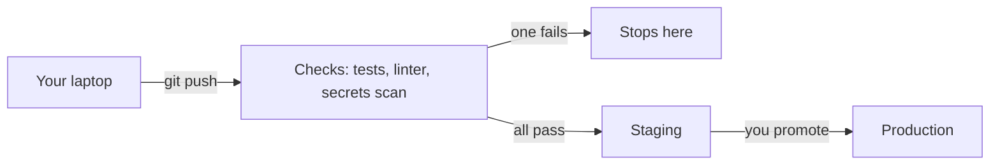

# Staging and production

Session 24 · Tuesday, November 24, 2026, on Zoom

Your agent runs when you type a command on your laptop. Nobody else can use
it, and there's only one copy, so a change can't be checked anywhere before
it's the real thing. Today you'll put the agent behind a web page. Then a
change moves through three places before a visitor sees it: your laptop, a
staging site, and production.

## Objectives

By the end of class, you'll have:

- A page with a question box and an `/ask` route that runs your agent,
  behind a shared password.
- Tests, a linter, and a secrets scan that run on every push.
- A staging site and a production site on your EC2 instance, each at its own
  subdomain over HTTPS.
- One change that GitHub Actions deployed to staging and that you promoted
  to production.

## Learning objectives

By the end of this lesson, you should be able to:

- Say what local, staging, and production are each for.
- Explain the difference between a check you run by habit and a check the
  pipeline enforces.
- Follow one commit from your laptop to production.
- Explain how GitHub Actions deploys to a server that only accepts SSH from
  your IP address.
- Say where your API key lives in each environment, and why it isn't in the
  repository.
- Say what CI, CD, and DevOps mean, and point to each one in your own
  project.

## Three environments

An environment is one running copy of your app. Each copy has its own
address, its own settings, and its own job.

| Environment | Where it runs | Who sees it | What it's for |
| --- | --- | --- | --- |
| Local | Your laptop | You | Building and trying things |
| Staging | staging.yourname.com | You | Checking a change on the real server before visitors get it |
| Production | A subdomain you choose | Anyone with the password | The copy people use |

A change moves in one direction:



## A habit and a gate

Teams check code in more than one place. A check on your laptop is fast, and
you can skip it. A check in the pipeline is slower, and nothing deploys
until it passes.

| | On your laptop | In the pipeline |
| --- | --- | --- |
| When | Before you commit | After you push |
| What runs | `/code-review` and `/security-review` | Tests, a linter, and a secrets scan |
| Can you skip it? | Yes, so it's a habit | No, so it's a gate |

## CI/CD and DevOps

The path in the diagram has names, and job postings use them. You'll build
each one today.

| Term | What it means | Where it is today |
| --- | --- | --- |
| CI, continuous integration | Every push is checked by a machine, so a problem shows up while the change is still small | The tests, the linter, and the secrets scan in section 4 |
| CD, continuous delivery | Every commit that passes is ready to release, and a person decides when | The staging deploy in section 4 and your promotion in section 5 |
| Continuous deployment | The same path, but production updates with no person deciding | Not today |
| Pipeline | The steps a commit goes through, in order, from push to production | Your two GitHub Actions workflows |
| DevOps | The people who build the software also deploy it and keep it running, with automation doing the handoffs | Everything you do today |

Before DevOps, a development team wrote the code and handed it to a
separate operations team to run. Releases were rare, and each team blamed
the other when one failed. DevOps puts both jobs on one team and automates
the handoff. GitHub Actions is one tool for it. Jenkins, GitLab CI, and AWS
CodePipeline do the same work.

Some jobs own this work: DevOps engineer, site reliability engineer,
platform engineer, and cloud engineer. Most of those postings ask for two
to five years, so think of them as a second job. The first jobs use it
every day without the title. A technical support engineer reads a failed
deploy, an implementation specialist ships a customer's setup, and a data
analyst's report runs in a pipeline someone else built. Postings for those
jobs list CI/CD, Git, or GitHub Actions as a skill.

## 1. Build the app on your laptop

Open your Project 02 repository in VS Code and start a new Claude Code
session named with:

```text
/rename staging-and-production
```

Your agent needs a way in. An API route is an address that takes a question
and returns an answer, and a page gives a person a box to type in. The
prompt asks for FastAPI, which is the framework your resume site uses. Ask
your agent:

```text
Read agent.py. Build a small web app around it with FastAPI:

- One page with a question box.
- One route, /ask, that takes the question, runs the agent loop in
  agent.py, and returns the answer.
- If the answer comes back as markdown, show it formatted, not as
  plain text.
- A shared password in front of the page and the route. Read it from
  the environment, never from the code.
- At the bottom of the page, show the environment name and the commit
  the app is running.

Keep agent.py working from the command line. Ask me before you add
anything else. Then run the app on my laptop and tell me the address.
```

Check it yourself:

1. Open the address and enter the password.
2. Ask the question you asked `agent.py` on Thursday. Compare the two
   answers.
3. Open the address in a private window and skip the password. The app
   should refuse you.
4. Ask one vague question, such as "show me a report." Write down what the
   agent does. You'll use it in section 5.

The password is your access gate. Every question costs you API credits, so
only people you allow should reach the agent.

Now run the two reviews, one at a time:

```text
/code-review
```

```text
/security-review
```

Read the findings and fix the ones you agree with. Then make the habit
easier to keep:

```text
Add a line to CLAUDE.md: before every commit, run a code review and a
security review, and show me the findings.
```

That line is a reminder. Nothing makes it run.

## 2. Add the checks

A gate needs checks a machine can run without you. Ask:

```text
Add two checks, each run with one command:

- Tests for the app and for the tool in agent.py. They must not call
  the model or need my API key. Include a test that a request without
  the password is refused.
- The ruff linter.

Run both and show me the results. If a test fails, tell me why. Don't
delete it.
```

Open the test file and find the test for the password. Read it until you
can say what it sends and what it expects back.

Check that no file except `.env` holds your key or your password. Then ask:

```text
Commit and push.
```

## 3. Get your instance ready

This section is setup you do once. The pipeline reuses it on every deploy.

Choose a name for your production subdomain, such as the name of your
repository. In the prompts below, replace `yourname.com` with your domain
and `yourproject` with that name.

Start with DNS:

```text
Using the Cloudflare CLI, add two A records that point at my
instance's Elastic IP, DNS only: staging and yourproject. Don't
change any other record.
```

Ask DNS from your laptop. Both answers should be your Elastic IP:

```bash
nslookup staging.yourname.com
nslookup yourproject.yourname.com
```

Next, ask for a plan and read it before anything changes:

```text
Plan how to run two copies of this app on my EC2 instance, next to
my resume site: staging at staging.yourname.com and production at
yourproject.yourname.com.

Each copy gets its own folder, service, port, environment file, and
Let's Encrypt certificate. Nginx routes by hostname. My resume site
has to keep working.

Don't copy the app's code to the instance. The pipeline will do
that. Show me the plan before you change anything.
```

Find three things in the plan: the two ports, the two environment files,
and the step that could break your resume site. Then ask:

```text
Carry out the plan one part at a time, and show me each check.
```

Each copy needs your API key and its own password. They go in the
environment files on the instance, and they stay out of GitHub:

```text
Copy my API key from .env into both environment files on the
instance without printing it. Set the environment name to staging in
one and production in the other. Ask me for a different password for
each.
```

Open both addresses in your browser. Each should show a padlock and a 502
error. Nginx and the certificate are working, and no app is behind them
yet. Check that your resume site still loads.

### How GitHub reaches your instance

GitHub Actions runs each job on a runner, which is a machine that carries
out the steps. GitHub's own runners can't SSH into your instance, because
port 22 only allows your IP address. So your instance runs a runner of its
own. It asks GitHub for jobs, and nothing new opens on your firewall.

```text
Install a GitHub Actions self-hosted runner on my instance for this
repository, and run it as a service. Tell me what you need from me.
```

In your repository on GitHub, open Settings, then Actions, then Runners.
Your runner should show Idle. Use a self-hosted runner only on a private
repository, since a public one would let a stranger's pull request run
code on your instance.

## 4. Deploy to staging with GitHub Actions

Ask:

```text
Write a GitHub Actions workflow for this repository.

On every push to main, run the tests, ruff, and a gitleaks secrets
scan on GitHub's runner. If all three pass, deploy that commit to
staging on my self-hosted runner and restart the staging service. If
one fails, nothing deploys.

Before I commit, explain each job to me in one line.
```

Before you push, predict what the Actions tab will show, and in what order.
Then ask:

```text
Commit and push.
```

Open the Actions tab in your repository and watch the run. While it runs,
check your own postings for today's terms:

```text
Search my saved postings in research/ for CI/CD, DevOps, pipeline,
deployment, GitHub Actions, and staging. Show me each line you find
and which posting it's from. Don't summarize.
```

When the run finishes:

1. Open staging.yourname.com and enter the staging password.
2. Read the bottom of the page. It should say staging, with a commit.
3. Run `git log -1` on your laptop and compare the commit.
4. Ask the agent a question.

Production still shows the 502 error, because nothing has been promoted.

## 5. Promote to production

Staging has a commit that passed the checks, and you've tried it. Promoting
it is your decision, so you start it by hand:

```text
Add a second workflow named Promote that I start by hand from the
Actions tab. It deploys the commit staging is running to production
and restarts the production service.
```

Commit and push, and wait for the staging deploy to finish. In the Actions
tab, choose Promote, then Run workflow. When it finishes, open your
production address. The bottom of the page should say production, with the
same commit as staging.

Now move one real change through all three environments. In section 1 you
asked a vague question. If your agent answered with a question of its own,
the page gave you no way to reply. Your agent gets one request and returns
one answer, so it needs enough to act without you.

Open `agent.md` and add two things, in your own words:

- What data the agent has: the source, the topics, and the dates it
  covers.
- What it does with a vague request. A good rule is to pick a reasonable
  default, do the work, and say what it assumed.

Then ask:

```text
I added two things to agent.md: what data the agent has, and what it
does with a vague request. Update agent.py to match, and give the
agent today's date. Change nothing else. Then run the tests.
```

Move the change through:

1. Ask the vague question again on your laptop. The agent should answer
   and say what it assumed.
2. Run the two reviews, then commit and push.
3. Watch the checks. Ask the vague question on staging. Production still
   gives the old answer.
4. Run Promote. Both sites now show the same commit.

If your agent already handled the vague question, change the heading on
the page and move that through.

Then explain it back, in your own words:

```text
I'll explain what happens between git push and a visitor seeing my
change, one line per step. Tell me only where I'm wrong.
```

Teams with a paid GitHub plan add two rules to this path. A change can't
merge until the checks pass, and production waits for a named person to
approve. GitHub Free doesn't offer either on a private repository, so your
checks gate the deploy and you promote by hand.

## 6. What's next

- By Tuesday, December 1, at 1:45 PM, M2 is due: your app is live at your
  production subdomain behind the password, and one commit moved from
  staging to production. Submit both addresses and both passwords in
  Brightspace. The passwords stay out of your repository.
- Tuesday, December 1, is the LMU Data Center tour. Meet in University Hall
  in front of Einstein Bros. Bagels.
- Your app reads the saved data in your repository for now. On Thursday,
  December 3, the data moves to S3 or RDS, and the agent gets access to
  only what it needs.
- The [Project 02 requirements](../projects/project-02.md#dates) have the
  new dates and the parts that changed.

If something breaks between now and December 1, write down what you saw and
what fixed it. Exercise 10 is now one real failure from your own project,
in your own words, due Tuesday, December 8.
