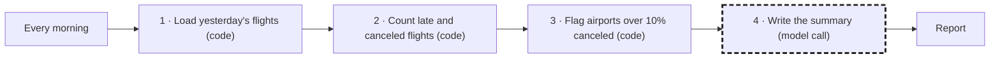
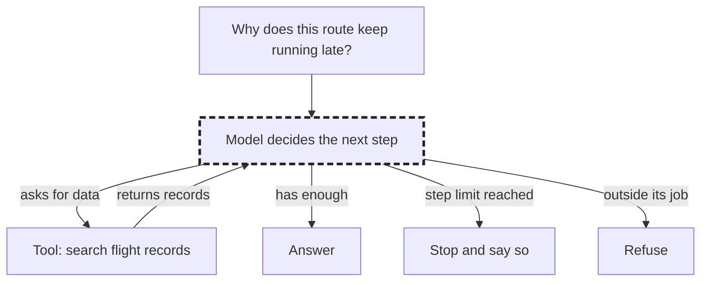

# A workflow and an agent

Session 22 · Tuesday, November 17, 2026

On Thursday you sent one record to a model, and your code decided what the
model saw. Today you'll answer one question two ways. In a workflow, your
code decides every step. In an agent, the model decides the next step, and
your code stops it at a limit. Today doesn't use AWS.

## Today's objectives

By the end of class, you'll have:

- One workflow written as numbered steps and one agent drawn as a loop, both
  for your posting.
- `workflow.py`, which answers a question with one model call.
- `agent.py`, which answers the same question with one tool and a step limit.
- A table comparing the two runs.

## Learning objectives

By the end of this lesson, you should be able to:

- Sort a posting's duties into fixed steps and agent decisions.
- Explain what a tool is and who runs it.
- Follow one agent run step by step.
- Say why an agent needs a step limit.
- Compare a workflow and an agent on calls, tokens, and cost.

## Workflow or agent

Both use a model. The difference is who decides the next step.

In a workflow, your code decides. The steps run in the same order every
time, and you wrote them before any data arrived. A model call can be one of
the steps. This workflow sends an airline's daily on-time report:



In an agent, the model decides. It asks your code to run a tool, reads what
comes back, and chooses what to do next. Your code keeps it in a loop and
ends the run at a step limit. This agent looks into one late route:



The workflow is a line, and the agent is a loop with three ways out.

| | Workflow | Agent |
| --- | --- | --- |
| Who decides the next step | Your code | The model |
| The steps | Known before the data arrives | Chosen during the run |
| Model calls | A fixed number | As many as it takes, up to the limit |
| Cost | Predictable | Changes from run to run |
| Use it when | You can list the steps ahead of time | The next step depends on what the last one found |

Most systems are mostly workflow. The agent goes where the steps can't be
listed ahead of time.

## 1. Sort the duties, then write it on paper

In VS Code, open View, then Command Palette. Choose:

```text
Claude Code: Open in New Tab
```

In the new tab's prompt box, enter:

```text
/rename workflow-and-agent
```

Ask your agent for the posting's duties:

```text
Read my chosen posting. List its duties as a numbered list, one line
each, in the posting's own words. Don't sort or judge them yet.
```

Decide W for workflow, A for agent, or N for neither on each duty, and jot
your marks down. Some duties, such as becoming an expert, aren't tasks a
system runs. Then have your agent mark them without showing you, so neither
of you sees the other's answer first:

```text
I'm deciding which duties my system handles with fixed steps and which
need an agent. I want your independent judgment, not agreement.

For each duty in the list above, choose one:
- Workflow: the steps can be listed before seeing the data.
- Agent: the next step depends on what the last one found.
- Neither: it's a person's job, not a task a system runs.

1. Judge from the posting's wording only. Give one reason per duty.
2. Save your marks to duty-marks.md in the repository's top folder.
   Don't show them in chat.
3. Ask me for my marks, in a form like: 1 W, 2 A, 3 N.
4. Show both sets in one table. Don't change yours.
5. Where we differ, give the best case for each side, then stop.
   I'll decide.
```

Answer with the marks you wrote down, such as `1 W, 2 A, 3 N`. Don't change
them if you see your agent's first. Where the two of you differ, read both
cases. You decide each one, and you write one line on why.

Then, on paper:

1. Pick one W duty and write its workflow: when it starts, its numbered
   steps, and what it produces. Label each step as code or a model call.
2. Pick one A duty and draw its agent: the model, its tools, the answer, the
   stop, and what it refuses.
3. Trade with a neighbor. Find the three ways the agent's run can end.

Keep the paper. You'll add both to your repository after class.

## 2. Set up Python

Today's calls run from [Python](https://www.python.org/downloads/) scripts.
A [virtual environment](https://docs.python.org/3/library/venv.html) keeps
this project's packages separate from the rest of your laptop. An SDK is a
package that builds and sends API requests for your code.

Ask your agent:

```text
Set up Python for this repository. Check that Python 3 is installed.
Create a virtual environment in .venv and keep it out of Git. Install
the Anthropic Python SDK and record it in requirements.txt. Then stop.
```

Thursday's rules for your key still hold. This prompt sets them for today:

```text
Today's model calls run from Python scripts. Each script loads my key
from .env when it runs. Never open .env, print the key, or write the
key into a script. Use the model from my saved requests.
```

If you chose another provider, install its SDK and give your agent its tool
docs in section 4.

## 3. Build the workflow

Write one question that compares two things in your data, so it takes a few
of your records to answer. Work out the answer by hand first, so you can
check both runs against it.

Replace `[your question]` below with yours, then ask:

```text
Read the API docs first:
https://platform.claude.com/docs/en/api/messages/create

Write workflow.py. It loads all my saved records, sends them with this
question in one model call, and prints the answer as JSON:
[your question]

Print the number of model calls, the input and output tokens, and the
cost. Use my model's row on this page:
https://platform.claude.com/docs/en/about-claude/pricing

Run it, save the output in runs/, and show it to me. Then stop.
```

Check the answer against the one you worked out. Check that the price row
matches your model's exact name, because similar names have different
prices. Then open `workflow.py` and find:

- Where it loads your records.
- The one model call.
- The line that decides what the model sees. Your code wrote it, and the
  model had no say.

## 4. Add one tool and the loop

A [tool](https://platform.claude.com/docs/en/agents-and-tools/tool-use/overview)
is a function in your code that the model can ask you to run. The model
can't run it. It replies with the tool's name and inputs. Your code runs the
function and sends back the result. The loop repeats that exchange until the
model answers or your step limit ends the run.

Ask your agent:

```text
Read the tool use docs first:
https://platform.claude.com/docs/en/agents-and-tools/tool-use/how-tool-use-works
https://platform.claude.com/docs/en/agents-and-tools/tool-use/build-a-tool-using-agent

Write agent.py for the same question, with the same JSON answer.
Leave the records out of the request. Give the model one tool that
searches my saved data. The tool needs a search term and returns only
the matching records, never the whole file. Write the loop by hand,
without the tool runner.

A step is one model call. Allow one tool call per step and stop after
5 steps. If it reaches the limit without an answer, end the run and
say so. Print each step: its number, the tool, the inputs, and how
many records came back. Then print the same totals as workflow.py.

Run it, save the output in runs/, and show it to me. Then stop.
```

In the output, find:

- What the model searched for at each step. The model chose those words.
- The step where it stopped asking and answered.
- The number of model calls. Each step is one request to the API.

In `agent.py`, find:

- The tool's description. It's all the model knows about your tool.
- The loop.
- The step limit.

Check that the stop works. Ask:

```text
Set the step limit to 1 and run agent.py again. Save that output too.
Then set the limit back to 5.
```

The run should end at the limit without an answer, and say so. An agent with
no limit keeps asking, and each request spends your credits.

## 5. Compare the two runs

Ask your agent:

```text
Compare the workflow.py run with the agent.py run at 5 steps, using
the saved outputs: model calls, input tokens, output tokens, cost, and
the answer. Save the table as a new wiki page named workflow-vs-agent.
Don't overwrite an existing page.
```

Then answer these yourself:

- Did both runs match the answer you worked out by hand?
- Which run cost more, and why?
- Which one would you use for this question?
- Which duty in your posting fits the other one better?

On Thursday the guide asked whether one call was an agent. Answer it again
for `agent.py`, in your own words.

Check that no project file except `.env` holds your key. Then ask:

```text
Commit and push.
```

## 6. What's next

- By Thursday, November 19, your AWS site is working. Thursday's lesson
  deploys to it. If it isn't, finish the [AWS migration](aws-migration.md)
  or come to office hours.
- By Tuesday, November 24, M2 is due: your app is live at a subdomain of
  your domain over HTTPS. The
  [Project 02 requirements](../projects/project-02.md#dates) list it.
- Add your written workflow and your agent diagram to your repository,
  beside your M1 diagram.

Two optional pieces explain today's idea in a few minutes each:

- Simon Willison on what "agent" means:
  https://simonwillison.net/2025/Sep/18/agents/
- Barry Zhang on when to build an agent:
  https://www.youtube.com/watch?v=D7_ipDqhtwk
