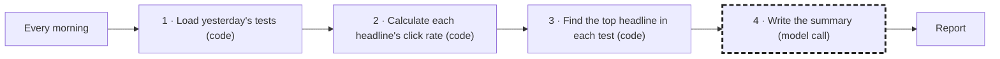
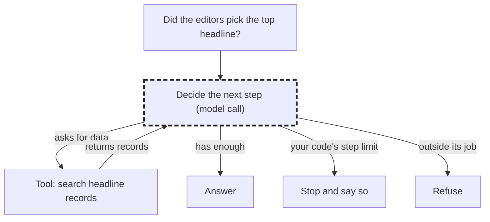

# A workflow and an agent

Sessions 22 and 23 · Tuesday, November 17, and Thursday, November 19, 2026

On November 12 you sent one record to a model, and your code decided what
the model saw. This lesson answers one question two ways. In a workflow,
your code decides every step. In an agent, the model decides the next step,
and your code stops it at a limit. Neither class uses AWS.

Tuesday covered sections 1 and 2 and a first `workflow.py`. Thursday starts
at section 3. Its prompt was wrong on Tuesday: it asked for one model call,
so the script skipped the steps you designed. Section 3 now has you write
the steps first, and your agent builds only what you wrote.

## Objectives

By the end of Thursday's class, you'll have:

- One workflow and one agent designed for your posting, saved in your wiki.
- `steps.md`, your workflow's steps, written by you before any code.
- `workflow.py`, which runs those steps, with code for the exact work and at
  most one model call.
- `agent.py`, which answers the same question with one tool and a step limit.
- A table comparing your runs, including Tuesday's one-call run.

## Learning objectives

By the end of this lesson, you should be able to:

- Sort a posting's duties into fixed steps, agent decisions, and work for a
  person.
- Write a workflow's steps before an agent writes the code, and check the
  code against them.
- Explain what a tool is and who runs it.
- Follow one agent run step by step.
- Say why an agent needs a step limit.
- Compare a workflow and an agent, and two models, on calls, tokens, and
  cost.

## Workflow or agent

Both make model calls. The difference is who decides the next step, and
what each model call is for.

In a workflow, your code decides. The steps run in the same order every
time, and you wrote them before any data arrived. A model call is one of
those steps. It does the one job your code gave it, and your code moves on.
The example is an analyst at a health website who studies headline tests.
This workflow sends the daily report on those tests:



In an agent, the model decides. Every pass through the loop is a model call.
Each time, the model reads everything so far and chooses: ask your code to
run a tool, or answer. Your code keeps it in the loop and ends the run at a
step limit. This agent answers a manager's one-off question about the same
tests:



The workflow is a line, and the agent is a loop with three ways out. The
dashed box in each diagram is a model call. The workflow reaches its model
call once. The agent comes back to its model call on every pass.

| | Workflow | Agent |
| --- | --- | --- |
| Who decides the next step | Your code | The model |
| The steps | Known before the data arrives | Chosen during the run |
| What a model call does | One job your code gave it | Chooses the next step, or answers |
| How many model calls | A fixed number | As many as it takes, up to the limit |
| Cost | Predictable | Changes from run to run |
| Use it when | You can list the steps ahead of time | The next step depends on what the last one found |

Most systems are mostly workflow. The agent goes where the steps can't be
listed ahead of time.

## 1. Sort the duties, then design both

In VS Code, open View, then Command Palette. Choose:

```text
Claude Code: Open in New Tab
```

In the new tab's prompt box, enter:

```text
/rename workflow-and-agent
```

Ask your agent for the posting's duties:

```text
Read my chosen posting. List its duties as a numbered list, one line
each, in the posting's own words. Don't sort or judge them yet.
```

Mark each duty W for workflow, A for agent, or N for neither before you go
on. Ask two questions about each one:

1. Is it a task a system can run, or is it a person's job, such as learning a
   field or owning a decision? If it's a person's job, mark N.
2. Can you list the steps before you see the data? If you can, mark W. If the
   next step depends on what the last one found, mark A.

Then have your agent mark them without showing you, so neither of you sees
the other's answer first:

```text
I'm deciding which duties my system handles with fixed steps and which
need an agent. I want your independent judgment, not agreement.

For each duty in the list above, choose one:
- Workflow: the steps can be listed before seeing the data.
- Agent: the next step depends on what the last one found.
- Neither: it's a person's job, not a task a system runs.

1. Judge from the posting's wording only. Give one reason per duty.
2. Save your marks to duty-marks.md in the repository's top folder.
   Don't show them in chat.
3. Ask me for my marks, in a form like: 1 W, 2 A, 3 N.
4. Show both sets in one table. Don't change yours.
5. Where we differ, give the best case for each side, then stop.
   I'll decide.
```

Answer in the chat with your marks, such as `1 W, 2 A, 3 N`. Don't change
them if you see your agent's first. Where the two of you differ, read both
cases. You decide each one. Tell your agent your decision and why in one
line, so it's saved with the marks.

Then design one workflow and one agent for your posting. You do the
thinking, and your agent writes it down:

```text
I'll design one workflow and one agent for my posting. I do the
thinking. Don't write either one for me.

1. In one message, ask me for the W duty I picked and its workflow:
   when it starts, its numbered steps with each one labeled code or
   model call, and what it produces.
2. In one message, ask me for the A duty I picked and its agent: the
   question it gets, its tools, when it stops, and what it refuses.
3. Save both in my words as a new wiki page named
   my-workflow-and-agent, with a Mermaid diagram of each.
4. Tell me the three most important things that are missing or
   unclear. Don't fix them. I'll decide.
```

If you marked no duty A, use the agent from the board with a question about
your own data. Then check your agent's diagram for three ways out: an answer,
a stop at the step limit, and a refusal.

## 2. Set up Python

This lesson's calls run from [Python](https://www.python.org/downloads/) scripts.
A [virtual environment](https://docs.python.org/3/library/venv.html) keeps
this project's packages separate from the rest of your laptop. An SDK is a
package that builds and sends API requests for your code.

Ask your agent:

```text
Set up Python for this repository. Check that Python 3 is installed.
Create a virtual environment in .venv and keep it out of Git. Install
the Anthropic Python SDK and record it in requirements.txt. Then stop.
```

The November 12 rules for your key still hold. This prompt sets them again:

```text
Today's model calls run from Python scripts. Each script loads my key
from .env when it runs. Never open .env, print the key, or write the
key into a script. Use the model from my saved requests.
```

If you missed November 12, you don't have a key or saved requests yet. Work
through [Your first model call](first-model-call.md) first.

If you chose another provider, install its SDK and give your agent its tool
docs in section 4.

## 3. Write the steps, then build the workflow

Thursday starts here. On Tuesday most `workflow.py` scripts sent every
record to the model and let it do the math. In my run, the model added up
both weeks correctly and still said views went down. My design had five code
steps, and the script skipped all of them.

Ethan Mollick's advice for using AI without handing it your thinking is to
think first and write first, then let the AI push your work further:
https://www.oneusefulthing.org/p/against-brain-damage

This section follows that order. You write the steps, your agent builds
exactly those steps, and you check the result.

### Write steps.md in your own words

Start a new session, so Tuesday's one-call build doesn't steer your agent.
In VS Code, open View, then Command Palette. Choose:

```text
Claude Code: Open in New Tab
```

In the new tab's prompt box, enter:

```text
/rename workflow-steps
```

Work from the end. First say what finished looks like: a report, a ranked
list, a label on each record, a recommendation, or an alert. Then say what
data that output needs, and check that your data has it. Then write the one
or two steps in between. You can add more later. If Tuesday's question fits
that output, keep it.

Your data only has to connect to the company, so it might not support this
duty. If it doesn't, write down what you'd add or replace. For today, keep
going with an output your saved data can produce.

Know the rule for each step before you start. Anything that has to be exact
goes in code: loading, filtering, counting, adding, and comparing. A model
call writes words from numbers your code already computed. Most workflows
need one model call at the end, and some need none. My `steps.md` ends with
two sentences for the editors. Four code steps and one model call produce
them.

Open your design on the `my-workflow-and-agent` wiki page. Then ask your
agent:

```text
Help me write steps.md for my workflow. I do the thinking. Don't
suggest answers or steps, give examples, or calculate anything.

Ask me one question at a time, and wait for my answer. Start from
the end:
1. Which duty does this workflow do? List the duties I marked W in
   duty-marks.md and my my-workflow-and-agent wiki page, and let me
   pick one. If I don't have them, list the duties in my posting.
2. The end. What does this duty produce, and who uses it? Then ask
   me to write one example of that output, and the question it
   answers.
3. The beginning. What data does that output need? After I answer,
   show me the column names and the first 5 records of my saved
   data, exactly as saved. Don't summarize them or point out
   patterns. Then ask: does my data have what the output needs? Do
   I keep it, add to it, or replace it?
4. What starts the work?
5. The middle. What are the one or two steps from that data to that
   output? Ask for one step at a time: is it code or a model call,
   and what goes in and what comes out? Stop after two steps.
6. What will I check after the run?

Save my answers in my words as steps.md in the top folder. Then tell
me the three most important gaps, such as an output nobody in this
job would use, data that can't produce the output, a step with no
input, or math marked as a model call. Don't fix them. I'll decide.
```

Your example in question 2 can use placeholder numbers. If your agent offers
an answer, a step, or a number, say no and give your own.

A workflow answers a question you knew ahead of time, so your question now
lives in `steps.md` and not on the command line.

### Decide where your data goes

Your 20 records from Exercise 08 were a first sample. If you chose to keep
your data or add to it, download the full dataset now. Ask your agent:

```text
Download the full dataset from the source of my saved records, not
only 20. Save it in data/ with its source and today's date. If the
file is over 50 MB, add it to .gitignore and tell me. Then tell me how
many records it has. Don't analyze it or summarize it.
```

If your source is slow or blocked, or you chose to replace your data, keep
your 20 records for today and get the full dataset tonight.

The full dataset needs a home on AWS. Look at the code steps in your
`steps.md`, then use this to decide:

| Put it here | When |
| --- | --- |
| [S3](https://aws.amazon.com/s3/) | You keep the file as it arrived, and your code reads all of it |
| [RDS](https://aws.amazon.com/rds/) | Your code filters, counts, joins, or updates rows |
| Your repository | A small sample you check by hand |

Keep it as it arrived in S3, ask it questions in RDS, and check it by hand
from the sample. Many systems use all three. Your RDS database already runs
for your resume site, and S3 costs cents at this size.

If your design is serverless and you look items up by one key, DynamoDB
also works. You don't need a vector database for this project.

Today you only decide. Your workflow still runs on your saved records, so
you can check its output against them. You load the full dataset into
AWS storage in class on Thursday, December 3.

### Build it from your steps

Ask your agent:

```text
Read steps.md. Rewrite workflow.py to follow it exactly, one
function per step, in the same order. Rename the old script to
workflow-one-call.py.

Only the step I marked model call calls the model, and it gets the
numbers my code computed, never the records. Don't add, merge, or
skip steps. If a step is unclear, ask me before you write code.

Print the same totals as before: model calls, input and output
tokens, and cost. Before you run it, ask me what I expect it to
print. Then run it, save the output in runs/, and show me.
```

Answer its question with the numbers you expect from your saved records.
Then check the output against them. If a number is wrong, the bug is in code
you can read, so find the step that made it.

Open `workflow.py` and find:

- One function for each of your steps.
- The one model call, and what it's given.
- The line you'd change if your threshold or date range changed.

Then explain the file back to your agent, in your own words:

```text
I'll explain what each function in workflow.py does, one line each.
Tell me only where I'm wrong. Don't rewrite the code.
```

Compare this run with Tuesday's in `runs/`: the input tokens, the cost, and
whether each answer was right. My run went from 1,379 input tokens and a
wrong answer to 312 input tokens and a right one, at about a fifth of the
cost.

## 4. Add one tool and the loop

A [tool](https://platform.claude.com/docs/en/agents-and-tools/tool-use/overview)
is a function in your code that the model can ask you to run. The model
can't run it. It replies with the tool's name and inputs. Your code runs the
function and sends back the result. The loop repeats that exchange until the
model answers or your step limit ends the run.

Open this page and read its first section, "The tool-use contract." Stop at
"Where tools run."

https://platform.claude.com/docs/en/agents-and-tools/tool-use/how-tool-use-works

### Write agent.md in your own words

Stay in the session you used for `steps.md`. Open the agent on your
`my-workflow-and-agent` wiki page.

Work from the end again. The end is the answer and who asks for it. The
beginning is what your tool can reach. The middle is different. The model
chooses the steps, so you can't write them. You write its limits: the tool
description, the step limit, and what it refuses.

An agent needs a tool, and it doesn't have to be a search. A tool can
search your records, look up one record, calculate, or call another system.
For today, pick one that works on your saved records, so you can check what
comes back.

Ask your agent:

```text
Help me write agent.md for my agent. I do the thinking. Don't
suggest answers, give examples, or write the tool description.

Ask me one question at a time, and wait for my answer. Start from
the end:
1. Which duty is my project's agent for? List the duties I marked A
   in duty-marks.md and my my-workflow-and-agent wiki page, and let
   me pick one. If I don't have them, list the duties in my posting.
2. The end. Who asks this agent a question, and what does a good
   answer look like? Then show me the question in steps.md. Today's
   run uses it. Ask me to confirm it.
3. The beginning. What does the tool do, and what does it return?
   The model knows only what my description says.
4. The middle. Can I list the steps ahead of time? If I can, it's a
   workflow. Ask me for one question from this duty where I can't,
   and why.
5. The limits. What's the step limit, and what does the agent
   refuse?
6. What do I expect the model to ask the tool for, for today's
   question?

Save my answers in my words as agent.md in the top folder. Then tell
me the three most important gaps, such as a tool description that
doesn't say what comes back, a question that fixed steps can answer,
or no refusal rule. Don't fix them. I'll decide.
```

A step is one model call. If your agent offers an answer or writes the
tool description, say no and give your own.

If you built `agent.py` on Tuesday night, write `agent.md` anyway. Then
compare it with what your agent built, and keep the script.

### Build it from agent.md

Ask your agent:

```text
Read the tool use docs first:
https://platform.claude.com/docs/en/agents-and-tools/tool-use/how-tool-use-works
https://platform.claude.com/docs/en/agents-and-tools/tool-use/build-a-tool-using-agent

Read agent.md. Write agent.py from it, complete in one file. Use my
tool description word for word, and put my refusal rule in the
system prompt. Leave the records out of the request, so the tool is
the only way to the data. The tool returns only what my description
says.

Write the loop by hand, without the tool runner. Allow one tool call
per step, and end the run at my step limit. Print each step: its
number, the tool, the inputs, and what came back, in one line. Print
the same totals as workflow.py.

Run it with today's question, the one from steps.md. Save the
output in runs/ and show me. Then stop.
```

In the output, find:

- What the model asked the tool for at each step. Compare that with your
  guess in `agent.md`.
- The step where it stopped asking and answered.
- The number of model calls. Each step is one request to the API.

In `agent.py`, find:

- Your tool description.
- The loop.
- The step limit.

Check that the stop works. Ask:

```text
Set the step limit to 1 and run agent.py again with the same
question. Save that output too. Then set the limit back.
```

The run should end at the limit without an answer, and say so. An agent with
no limit keeps asking, and each request spends your credits.

## 5. Try a second model, then compare

A smaller model costs less. A larger one costs more and often gets more
right. If you used Claude Haiku 4.5 on November 12, use Claude Opus 5.
If you used a larger model, use Claude Haiku 4.5.

Replace `[second model]` below, then ask:

```text
Add a --model option to workflow.py and agent.py. Keep my current
model as the default, and use each model's own row on the pricing
page. Then run both scripts on [second model]. Save the outputs in
runs/. Then stop.
```

Check both new answers against the answer you expected. Then ask:

```text
Compare my runs, using the saved outputs: Tuesday's one-call run,
and workflow.py and agent.py on each model. Show the model, model
calls, input tokens, output tokens, cost, and the answer. Save the
table as a new wiki page named workflow-vs-agent. Don't overwrite an
existing page.
```

Then answer these yourself, at the bottom of the `workflow-vs-agent` page:

- Which runs matched the answer you expected? If one didn't, what went
  wrong?
- Where did a model do work that your code could have done exactly?
- Which run cost the most, and why?
- What did the larger model buy you, and was it worth the cost?
- Which script and model would you use for this question?
- The agent you designed had three ways out. Which one is missing from
  `agent.py`?

On November 12 the guide asked whether one call was an agent. Answer it
again for `agent.py`, in your own words.

Check that no project file except `.env` holds your key. Then ask:

```text
Commit and push.
```

## 6. What's next

- By Tuesday, November 24, at 1:45 PM, Exercise 09 is due: `steps.md`,
  `workflow.py`, `agent.md`, `agent.py`, your saved runs, and the
  `workflow-vs-agent` page, committed and pushed. It's credit/no credit.
  Submit your repository URL and the paths to `steps.md` and `agent.md`
  in the Exercise 09 assignment in Brightspace.
- By Tuesday, November 24, your AWS site is working. That class, on Zoom,
  deploys to it with GitHub Actions. If it isn't working, finish the
  [AWS migration](aws-migration.md) or come to office hours.
- By Tuesday, December 1, at 1:45 PM, M2 is due: your app is live at a
  subdomain of your domain over HTTPS. It moved from November 24, so you
  can deploy with what that class teaches. The
  [Project 02 requirements](../projects/project-02.md#dates) list it.

### How the two scripts run on AWS

Today you start both scripts from your terminal. In your project, the same
code runs on AWS, and something other than you starts it.

| | Today | On AWS |
| --- | --- | --- |
| Workflow | You run `workflow.py` | A schedule or an event runs it. On EC2, cron is the simplest schedule. On serverless, [EventBridge Scheduler](https://aws.amazon.com/eventbridge/scheduler/) starts a [Lambda](https://aws.amazon.com/lambda/) function |
| Agent | You run `agent.py` | A route in your app takes a question and calls the same loop, behind your access gate |

The code stays the same, and what starts it changes. A schedule meets the
requirement, and so does an event from a second system. The
[Project 02 requirements](../projects/project-02.md#requirements) have the
rule.

Two optional pieces explain this lesson's idea in a few minutes each:

- Simon Willison on what "agent" means:
  https://simonwillison.net/2025/Sep/18/agents/
- Barry Zhang on when to build an agent:
  https://www.youtube.com/watch?v=D7_ipDqhtwk
