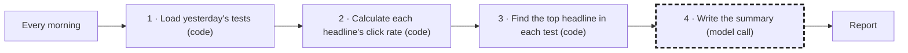
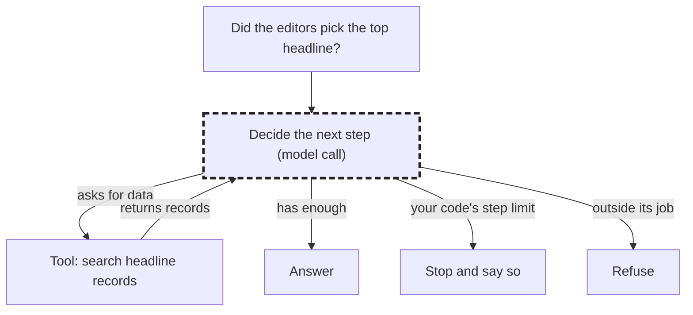

# A workflow and an agent

Session 22 · Tuesday, November 17, 2026

On Thursday you sent one record to a model, and your code decided what the
model saw. Today you'll answer one question two ways. In a workflow, your
code decides every step. In an agent, the model decides the next step, and
your code stops it at a limit. Today doesn't use AWS.

## Today's objectives

By the end of class, you'll have:

- One workflow and one agent designed for your posting, saved in your wiki.
- `workflow.py`, which runs the steps you wrote, with code doing every step
  it can.
- `agent.py`, which answers the same question with one tool and a step limit.
- A table comparing four runs: both scripts on two models.

## Learning objectives

By the end of this lesson, you should be able to:

- Sort a posting's duties into fixed steps, agent decisions, and work for a
  person.
- Split a workflow into code steps and model calls.
- Explain what a tool is and who runs it.
- Follow one agent run step by step.
- Say why an agent needs a step limit.
- Compare a workflow and an agent, and two models, on calls, tokens, and
  cost.

## Workflow or agent

Both make model calls. The difference is who decides the next step, and
what each model call is for.

In a workflow, your code decides. The steps run in the same order every
time, and you wrote them before any data arrived. A model call is one of
those steps. It does the one job your code gave it, and your code moves on.
The example is an analyst at a health website who studies headline tests.
This workflow sends the daily report on those tests:



In an agent, the model decides. Every pass through the loop is a model call.
Each time, the model reads everything so far and chooses: ask your code to
run a tool, or answer. Your code keeps it in the loop and ends the run at a
step limit. This agent answers a manager's one-off question about the same
tests:



The workflow is a line, and the agent is a loop with three ways out. The
dashed box in each diagram is a model call. The workflow reaches its model
call once. The agent comes back to its model call on every pass.

| | Workflow | Agent |
| --- | --- | --- |
| Who decides the next step | Your code | The model |
| The steps | Known before the data arrives | Chosen during the run |
| What a model call does | One job your code gave it | Chooses the next step, or answers |
| How many model calls | A fixed number | As many as it takes, up to the limit |
| Cost | Predictable | Changes from run to run |
| Use it when | You can list the steps ahead of time | The next step depends on what the last one found |

Most systems are mostly workflow. The agent goes where the steps can't be
listed ahead of time.

## 1. Sort the duties, then design both

In VS Code, open View, then Command Palette. Choose:

```text
Claude Code: Open in New Tab
```

In the new tab's prompt box, enter:

```text
/rename workflow-and-agent
```

Ask your agent for the posting's duties:

```text
Read my chosen posting. List its duties as a numbered list, one line
each, in the posting's own words. Don't sort or judge them yet.
```

Mark each duty W for workflow, A for agent, or N for neither before you go
on. Ask two questions about each one:

1. Is it a task a system can run, or is it a person's job, such as learning a
   field or owning a decision? If it's a person's job, mark N.
2. Can you list the steps before you see the data? If you can, mark W. If the
   next step depends on what the last one found, mark A.

Then have your agent mark them without showing you, so neither of you sees
the other's answer first:

```text
I'm deciding which duties my system handles with fixed steps and which
need an agent. I want your independent judgment, not agreement.

For each duty in the list above, choose one:
- Workflow: the steps can be listed before seeing the data.
- Agent: the next step depends on what the last one found.
- Neither: it's a person's job, not a task a system runs.

1. Judge from the posting's wording only. Give one reason per duty.
2. Save your marks to duty-marks.md in the repository's top folder.
   Don't show them in chat.
3. Ask me for my marks, in a form like: 1 W, 2 A, 3 N.
4. Show both sets in one table. Don't change yours.
5. Where we differ, give the best case for each side, then stop.
   I'll decide.
```

Answer in the chat with your marks, such as `1 W, 2 A, 3 N`. Don't change
them if you see your agent's first. Where the two of you differ, read both
cases. You decide each one. Tell your agent your decision and why in one
line, so it's saved with the marks.

Then design one workflow and one agent for your posting. You do the
thinking, and your agent writes it down:

```text
I'll design one workflow and one agent for my posting. I do the
thinking. Don't write either one for me.

1. In one message, ask me for the W duty I picked and its workflow:
   when it starts, its numbered steps with each one labeled code or
   model call, and what it produces.
2. In one message, ask me for the A duty I picked and its agent: the
   question it gets, its tools, when it stops, and what it refuses.
3. Save both in my words as a new wiki page named
   my-workflow-and-agent, with a Mermaid diagram of each.
4. Tell me the three most important things that are missing or
   unclear. Don't fix them. I'll decide.
```

If you marked no duty A, use the agent from the board with a question about
your own data. Then check your agent's diagram for three ways out: an answer,
a stop at the step limit, and a refusal.

## 2. Set up Python

Today's calls run from [Python](https://www.python.org/downloads/) scripts.
A [virtual environment](https://docs.python.org/3/library/venv.html) keeps
this project's packages separate from the rest of your laptop. An SDK is a
package that builds and sends API requests for your code.

Ask your agent:

```text
Set up Python for this repository. Check that Python 3 is installed.
Create a virtual environment in .venv and keep it out of Git. Install
the Anthropic Python SDK and record it in requirements.txt. Then stop.
```

Thursday's rules for your key still hold. This prompt sets them for today:

```text
Today's model calls run from Python scripts. Each script loads my key
from .env when it runs. Never open .env, print the key, or write the
key into a script. Use the model from my saved requests.
```

If you missed Thursday, you don't have a key or saved requests yet. Work
through [Your first model call](first-model-call.md) first.

If you chose another provider, install its SDK and give your agent its tool
docs in section 4.

## 3. Build the workflow

Your question needs a reason: someone in your posting's job would want the
answer. It also has to compare two things, so it takes a few of your records
to answer. Thursday's short interview helps you find one:

```text
Read my chosen posting and my saved records. Ask me two
multiple-choice questions, one at a time, to help me decide what
someone in this job would want to check in this data.

Then suggest one question that compares two things and takes a few
records to answer. Keep it simple enough that I can check the answer
by hand in two minutes. Give the reason someone in this job would ask
it. Let me revise it. Don't write code or send a model call yet.
```

Work out the answer by hand first, so you can check every run against it.

With your laptop closed, write your workflow's steps for this question on
paper. Number them and label each one code or model call, like the headline
example above. Code does every step it can do the same way every time:
loading, filtering, counting, comparing. A model call does only what code
can't, such as writing the answer in plain words.

Your agent writes the skeleton and the model call. You write the code steps.
Replace `[your steps]` and `[your question]` below, then ask:

```text
Read the API docs first:
https://platform.claude.com/docs/en/api/messages/create

Write workflow.py from my steps below: one function per step, in my
order, and a main that runs them. It takes the question as a
command-line argument and prints the answer as JSON.

For each step I labeled code, write only the function's name, inputs,
output, and a TODO. I'll write the body. For each step I labeled
model call, write the whole function.

Print the number of model calls, the input and output tokens, and the
cost. Use my model's row on this page:
https://platform.claude.com/docs/en/about-claude/pricing

Don't add, merge, or skip steps. If a step is unclear, ask me. Then
stop.

My steps:
[your steps]

My question:
[your question]
```

Fill in each TODO yourself. If you get stuck, ask for an explanation, not
the code:

```text
Explain what the TODO in [function name] needs to do and which Python
feature would help. Don't write the code.
```

Then run it. Replace `__` with the number of model-call steps on your paper:

```text
Run workflow.py with my question. Save the output in runs/ and show it
to me. My steps have __ model calls. Check that the printed count
matches. If it doesn't, tell me which step is wrong. Don't fix it.
```

Check the answer against the one you worked out. If it's wrong, don't fix
it. Keep the run and note what went wrong. You'll use it in section 5.

Check that the price row matches your model's exact name, because similar
names have different prices. Then open `workflow.py` and find:

- Where it loads your records.
- The model call.
- The line that decides what the model sees. Your code wrote it, and the
  model had no say.

Tell your agent what you found, so it can check you:

```text
In workflow.py, I think the records load on line __, the model call is
on line __, and line __ decides what the model sees. Check me. Don't
change the file.
```

Your code did the work it can repeat exactly. The model did only the step
you gave it.

## 4. Add one tool and the loop

A [tool](https://platform.claude.com/docs/en/agents-and-tools/tool-use/overview)
is a function in your code that the model can ask you to run. The model
can't run it. It replies with the tool's name and inputs. Your code runs the
function and sends back the result. The loop repeats that exchange until the
model answers or your step limit ends the run.

Open this page and read its first section, "The tool-use contract." Stop at
"Where tools run."

https://platform.claude.com/docs/en/agents-and-tools/tool-use/how-tool-use-works

Then ask your agent:

```text
Read the tool use docs first:
https://platform.claude.com/docs/en/agents-and-tools/tool-use/how-tool-use-works
https://platform.claude.com/docs/en/agents-and-tools/tool-use/build-a-tool-using-agent

Write agent.py. Like workflow.py, it takes a question as a
command-line argument and prints the same JSON answer. Keep agent.py
complete in one file. Don't import from workflow.py.

Leave the records out of the request. Give the model one tool that
searches my saved data. The tool needs a search term and returns only
the matching records, never the whole file. Write the loop by hand,
without the tool runner.

A step is one model call. Allow one tool call per step and stop after
5 steps. If it reaches the limit without an answer, end the run and
say so. Print each step: its number, the tool, the inputs, and how
many records came back. Then print the same totals as workflow.py.

Run it with the same question. Save the output in runs/ and show it
to me. Then stop.
```

In the output, find:

- What the model searched for at each step. The model chose those words.
- The step where it stopped asking and answered.
- The number of model calls. Each step is one request to the API.

In `agent.py`, find:

- The tool's description. It's all the model knows about your tool.
- The loop.
- The step limit.

Check that the stop works. Ask:

```text
Set the step limit to 1 and run agent.py again with the same
question. Save that output too. Then set the limit back to 5.
```

The run should end at the limit without an answer, and say so. An agent with
no limit keeps asking, and each request spends your credits.

The question is an argument, so you can ask another one without changing the
code. If you have time, try one and see which words the model searches for:

```text
Run agent.py with this question and show me the steps:
[another question]
```

## 5. Try a second model, then compare

A smaller model costs less. A larger one costs more and often gets more
right. Run both scripts again on a second model to see what changes. If you
used Claude Haiku 4.5 on Thursday, use Claude Opus 5. If you used a larger
model, use Claude Haiku 4.5.

Replace `[second model]` below, then ask:

```text
Add a --model option to workflow.py and agent.py. Keep my current
model as the default, and use each model's own row on the pricing
page. Then run both scripts with the same question on
[second model]. Save the outputs in runs/. Then stop.
```

Check both new answers against the one you worked out. Then ask:

```text
Compare my four runs, using the saved outputs: workflow.py and
agent.py at 5 steps, on each model. Show the model, model calls,
input tokens, output tokens, cost, and the answer. Save the table as
a new wiki page named workflow-vs-agent. Don't overwrite an existing
page.
```

Then answer these yourself:

- Did all four runs match the answer you worked out by hand? If one didn't,
  what went wrong?
- Which run cost the most, and why?
- What did the larger model buy you, and was it worth the cost?
- Which script and model would you use for this question?
- Which duty in your posting fits the other one better?
- The agent you designed had three ways out. Which one is missing from
  `agent.py`?

On Thursday the guide asked whether one call was an agent. Answer it again
for `agent.py`, in your own words.

Check that no project file except `.env` holds your key. Then ask:

```text
Commit and push.
```

## 6. What's next

- By Thursday, November 19, your AWS site is working. Thursday's lesson
  deploys to it. If it isn't, finish the [AWS migration](aws-migration.md)
  or come to office hours.
- By Tuesday, November 24, M2 is due: your app is live at a subdomain of
  your domain over HTTPS. The
  [Project 02 requirements](../projects/project-02.md#dates) list it.

Two optional pieces explain today's idea in a few minutes each:

- Simon Willison on what "agent" means:
  https://simonwillison.net/2025/Sep/18/agents/
- Barry Zhang on when to build an agent:
  https://www.youtube.com/watch?v=D7_ipDqhtwk
