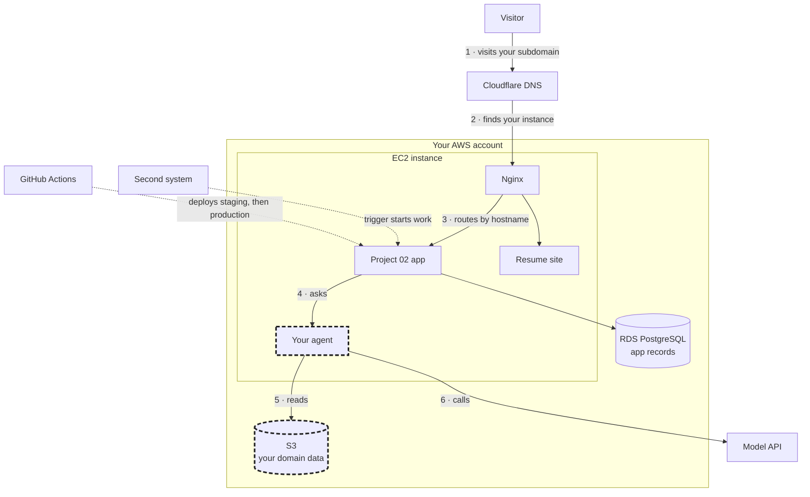

# Project 02

300 points. Due Thursday, December 10, 2026, at 1:45 PM, before class.

This is a first draft and is open to revisions.

## At a glance

| Question | Answer |
| --- | --- |
| What do I build? | You build the system a real job posting implies. It runs on AWS and includes an agent you built |
| Which posting? | Choose one for a job you could reach soon after graduation |
| What's the next-step posting for? | It shows how that work progresses in about two years. You don't have to want the role, and you won't build for it |
| Who designs the architecture? | You do. Compare at least two designs, choose one, and explain why |
| What's graded? | I grade what the system does and how well you can show it. Your choice of design isn't scored |
| Where do I start? | Start with [Find three postings for Project 02](../guides/find-your-project-02-postings.md) |

## Dates

Each milestone is graded when it's due. Its points are the areas of the
project that should be finished by then, and
[How the 300 points are earned](#how-the-300-points-are-earned) lists them.
If an area is missing or weak at its milestone, fix it before Project 02 is
submitted and you earn back half of the points you missed.

| Date | Due | Points |
| --- | --- | --- |
| Thu 11/12, 1:45 PM | Your posting, chosen from your three, and one next-step posting. You can switch among the three until 11/17 | |
| Tue 11/17 | M1: your PRD, your data source, and two architectures with cost estimates. Look for two or three open source projects you could extend, and record what you found. Name your choice and your reason, add a diagram, and rename your repository. Submit your repository URL in Brightspace, then keep building. I'll read your design and tell you by Thu 11/19 if something has to change | 60 |
| Thu 11/19 | Your AWS site is working, for the GitHub Actions lesson | |
| Tue 11/24 | M2: your app is deployed to production on your subdomain. Submit the address in Brightspace | 40 |
| Thu 12/3 | M3: your agent answers a grounded question with tools. Have three eval cases with expected answers ready. You'll show it live in class | 75 |
| Tue 12/8 | M4: two systems connect on a trigger, and one change moves from staging to production. You'll show it live in class | 60 |
| Thu 12/10, 1:45 PM | Project 02 is submitted, with the areas no milestone covers | 65 |
| Thu 12/17, 11:00 AM | Final whiteboard interview, worth a separate 300 points | |

## Requirements

Each row says what the system must do and the evidence you keep. The sections
after the table add detail where a row needs it.

| # | Requirement | What it has to do | Evidence |
| --- | --- | --- | --- |
| 1 | Posting and PRD | Choose one posting that passes the four tests, and save one next-step posting. Write a PRD that says who uses the system, what it does, and what it leaves out | Your wiki pages and the PRD |
| 2 | Runs on AWS | Your app, agent, and data run in your AWS account. The system answers over HTTPS at a subdomain of your domain, and your resume site keeps working | The live address, and an inventory of each resource with its cost and how you'd remove it |
| 3 | Agent | You build it or extend an existing one, and it does the job's repeated work. It uses at least one tool, returns structured output, and keeps the memory a task needs. It stops at a step limit and refuses requests outside its job | The live agent |
| 4 | Data | Use real data first. Store it on AWS, and give the agent credentials that allow only what it needs | Your data card and the access policy |
| 5 | Trigger | One event in a first system starts work in a second, with no one clicking in between. The work has to matter in the job's domain | A run you can show |
| 6 | Environments | You keep local, staging, and production environments. GitHub Actions deploys your changes, and secrets stay out of the repository | One commit followed from staging to production |
| 7 | Operations | Put an access gate and a rate limit on the agent. Set an AWS budget alert and a spend limit with your model provider. Record one useful analytics event, and have a way to know the system is down | Each one demonstrated |
| 8 | Evals | Write at least 10 cases with expected answers drawn from your data. The set runs from a clean clone with one command | Recorded results, including failures, and one trace a reader can follow |
| 9 | Architecture decision | Design two architectures that differ in a way that matters. Choose one and say what you gave up | The comparison and the decision record |
| 10 | Explain it | Write a blog post and draft a LinkedIn post, both for someone who isn't technical | Both submitted |
| 11 | Engineering record | Keep a README and a submission index. Every system will be different, so the index tells me how to check yours | `docs/project-02-submission.md` |

## Choosing a posting

A posting you can build from passes four tests. Here they are with one
example, a Customer Support Specialist posting at a bank.

| Test | The bank example |
| --- | --- |
| The job works with data you can get | Public complaints from the Consumer Financial Protection Bureau's database |
| A question or decision comes up again and again | "Which product and issue is this complaint about?" |
| You can tell whether the answer is right | The labels in each record |
| Two systems should talk to each other | A complaint form and a ticket queue |

Internships and entry-level roles both count, and you don't have to qualify
yet. Choose a job you'd want to interview for.

## Data

Real data comes first.

- Collect it through an MCP, an API, or a scrape of public pages.
- Use APIs and open data before you scrape, and scrape only pages whose terms
  allow it.
- Leave out personal data. An employer's private data doesn't count.
- Save one snapshot with its source and date, and have the app read it.

Made-up data is the fallback. If you need it, show that it's realistic for
the company in your posting.

1. Collect about 20 real examples from the same industry.
2. Write down the fields, the categories, and the share of each.
3. Generate your records from that description.
4. Compare a sample against the real examples by hand, and fix what's off.

Your data card says where the data came from, when and how you collected it,
and which parts are real and which are made up.

## Your design

The architecture is yours to design, within these rules.

| Choice | Rule |
| --- | --- |
| AWS | The app, the agent, and the data have to run on AWS. DNS can stay at Cloudflare, and the model API and a hosted tool that connects your two systems can live outside it |
| Model API | Find the right one to get the job done, and compare price and capability for your task. Class demos use the Claude API, and any provider counts |
| Fixed steps or agent | Your system has to be both. Decide which parts are fixed steps and which the agent decides, and be ready to defend where that line falls |
| From scratch or an existing project | You can build from scratch or extend an open source project. Find two or three you could extend, and record each in your wiki before M1. Check three things for each: its license allows your use, it runs within your budget, and you can show which changes are yours. Extending one can be one of your two designs. Bring its code into your private repository, because a GitHub fork of a public project stays public. If it already has an agent, I grade the agent work you add |
| Connecting two systems | This is a capability, not a tool. n8n, Make, Zapier, Power Automate, and code all count |
| Access gate | Each call to your agent spends your API credits, so only people you allow should reach it. A shared password or an invite code is enough, and user accounts aren't required |

For each of your two designs, give a diagram, a monthly cost estimate, what
it makes easy, and what it makes hard. A server compared with serverless
counts as a real difference. So does an agent that chooses its tools compared
with fixed steps and one model call.

Your decision record covers your most important decision, the evidence, how
AI contributed, and what you accepted, rejected, or changed. It also covers
how you validated the decision, your biggest remaining uncertainty, and what
comes next. Name one validation I can repeat, as a command or a request.

### The class path

Class lessons build one design, shown below. You can follow it, change it, or
design something else on AWS. If you leave it, you'll adapt the lessons to
your own design. It can be one of the two designs you compare.

Follow the numbers to trace one request. Your posting chooses the two parts
with a dashed border.

Your deployment policy from the AWS migration covers this path. A different
design needs different permissions, written with least privilege the same
way.

## Blog post and LinkedIn draft

Both help you explain your project to a general audience: what the job
needed, what you built, and how you know it works. They also prepare you for
the final interview, where you'll explain the same system out loud and
without notes.

You have to draft the LinkedIn post, but publishing it is up to you. We'll
work on both in class on December 8.

## How the 300 points are earned

I run the checks in the last column against your live system, so run them
yourself first. A claim the live system contradicts earns no credit for that
claim.

Each area is graded at the milestone in the second column. The areas marked
Final are graded on the submitted project.

| Area | Graded at | Points | What is assessed | Check I run |
| --- | --- | --- | --- | --- |
| Posting, PRD, and data | M1 | 30 | A posting that passes the tests, a PRD, and a data card showing real data or a documented realism check | I read them against your posting |
| Architecture decision | M1 | 30 | Two designs with costs and tradeoffs, your choice and what it gave up, and the diagram | I read them against your PRD |
| System on AWS | M2 | 40 | Working at your subdomain over HTTPS, and the resource inventory | I open the live address |
| Agent | M3 | 50 | The job's repeated work, done with a tool, structured output, memory, and guardrails. You can defend the line between fixed steps and agent decisions | I send three of your eval inputs and one out-of-scope request, then compare the answers with your expected answers |
| Grounding | M3 | 25 | Answers drawn from your stored data, reached with least-privilege credentials | I ask a question only your data answers, and I read the access policy |
| Orchestration | M4 | 25 | Two systems connected on a trigger, doing work that matters in the job | You show one trigger run at M4 |
| Environments and deployment | M4 | 35 | Three environments, GitHub Actions deploying, secrets handled, and one change shown moving through | I find one commit in your Actions history that deployed to staging and then to production |
| Decision record and index | Final | 10 | Your decision record, and a submission index that lets me check the system | I repeat the validation your decision record names |
| Operations | Final | 25 | Access, rate limit, cost controls, analytics, and monitoring | I request the agent without access, and I exceed the rate limit |
| Evals and trace | Final | 15 | An eval set with recorded results, including failures, and one readable trace | I run the eval set from a clean clone with one command |
| Blog post and LinkedIn draft | Final | 15 | A general reader can follow what you built, why, and how you know it works | I read both as a general reader |
| Total | | 300 | | |

A simple design that meets every requirement earns full credit, and adding
services doesn't add points. The late policy is in the
[syllabus](../syllabus.md).

## Repository and submission

- Your repository starts as `project-02`. It's private because it holds
  copied postings and your notes on jobs you're considering. By M1, rename
  it for the system you're building, such as `complaint-triage`.
- Invite me as a collaborator by M1, so I can read it.
- Keep your research in `research/` as an LLM wiki. Keep passwords, keys, and
  local environment files out of Git.
- In `docs/project-02-submission.md`, give your architecture diagram, your
  AWS services, and your staging and production addresses. Say how to get
  past the access gate and how to run each check above. Link the PRD, data
  card, comparison, decision record, eval results, and trace.
- Date your observations. Mark anything unverified instead of filling in the
  result you expected.

Submit through the Project 02 submission in Brightspace:

1. Your repository URL, your live HTTPS address, and your final commit SHA.
2. Your blog post, as a link or a file.
3. Your LinkedIn post draft. It stays out of the repository because it names
   you.

Keep the system running through your final interview.

## The final interview

The interview is Thursday, December 17, at 11:00 AM. It runs 20 minutes on
your own system from memory, including a changed constraint, then a
five-minute debrief. Treat it as an interview for the job you chose.

Be ready to:

- Draw your architecture and trace a request through it.
- Explain why you chose it over your other design.
- Show where the agent decides and where fixed steps run.
- Explain where your data came from and how you know the answers are right.
- Diagnose a failure, and discuss your costs.

## Costs

Stay inside the AWS free tier and your credits where you can. Estimate the
monthly cost of each design before you choose, and ask me before you pick a
service that will cost money.
